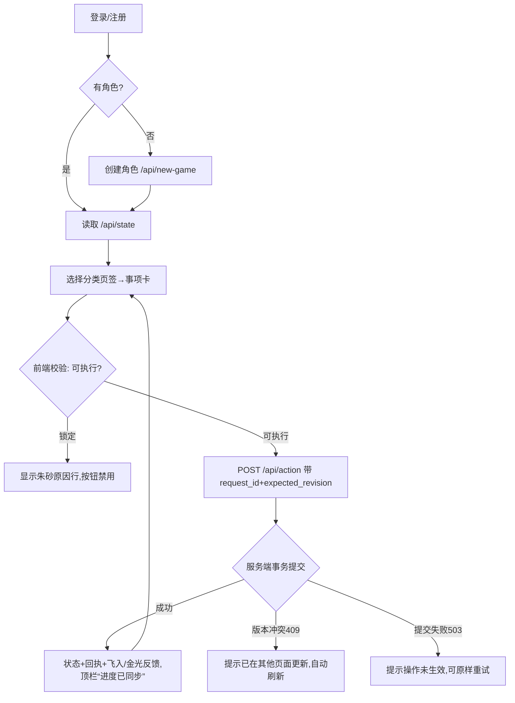
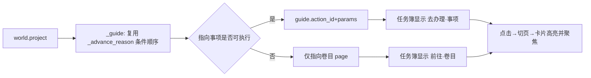

# 核心玩法流程

## 序章/凡界通用操作循环


## 自动斗法与战报回放（本轮三维特效挂接点）
```mermaid
sequenceDiagram
  participant P as 玩家
  participant UI as app.js
  participant S as 服务端
  participant R as battle_replay.js
  participant F as fx3d.js(Three.js)
  P->>UI: 点击自动斗法/选策略
  UI->>S: POST /api/action
  S->>S: 事务外演算整场,事务内原子结算
  S-->>UI: 状态 + battle_report(不入库)
  UI->>R: BattleReplay.open(report)
  R->>F: 动态 import,create(stage);失败/无WebGL→null,沿用SVG
  loop 每拍 frame.events
    R->>F: play(event, from, to, intensity=伤害/敌方气血上限)
    F->>F: 蓄力→飞行→命中冲击→收尾(PHASES 配置)
  end
  P->>R: 合上
  R->>F: dispose(释放几何/材质/纹理/上下文)
```
特效只读已结算战报；胜负、伤害、暴击以服务端逻辑结果为准，回放不重复结算。


## “下一步”指引（本轮新增）

指引只读：不改变进度，文案与 `summary` 一致，目标事项必须真实可执行（`tests/test_world_guide.py`）。

## 破坏性操作确认
服务端为动作下发 `confirm` 文案 → 前端复用 `confirm-dialog`（焦点落在“取消”）→ 确认后才 POST。已覆盖：退出宗门、解散家族、寄售、竞拍、分解装备、**封界、撤离副本、辞别师父**。

## 各卷目流程概要
| 卷目 | 主循环 |
|---|---|
| 九州 | 前往/采集/守候 → 材料入包 → 供其它卷目消耗 |
| 人物 | 吐纳/静养 → 满足条件突破 → 凡界终章 |
| 宗门 | 加入 → 日常交材料/接委托 → 贡献兑换 |
| 同道 | 交谈/赠礼 → 师徒/家族/弟子（派遣-归队） |
| 四艺 | 采集 → 制作（药/器/符/阵）→ 装备/使用 |
| 秘境 | 野外/劫影 → 秘境三节点 → 副本多战 → 自动斗法战报 |
| 洞府 | 升级设施 → 世界行动生产 → 收取 |
| 坊市 | 买卖/寄售/竞拍（NPC 模拟） |
| 闻道/名录/演武 | 任务接取与领取 → 成就称号 → NPC 演武与赛季 |
