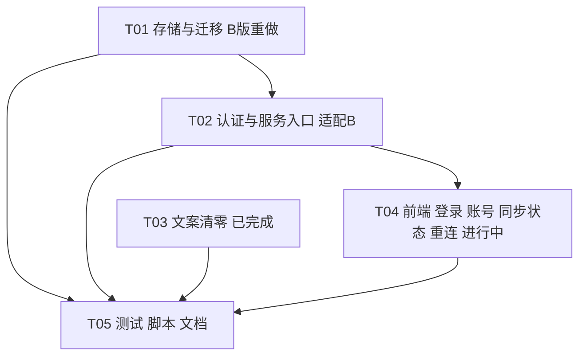

# MU_DESIGN：多用户在线化 · 增量系统设计 + 改造清单 + 任务列表

版本：v2（方案 B 修订）· 架构师 · 2026-10-21 · 依据：`MU_PRD.md`（AC1–AC21）、主理人已拍板的 12 项决策、以及用户最新决策「隔离方案由 A 改为 B：单库 `data/game.db` + `user_id` + WAL」（`MU_HANDOFF.md` 第 1、3、4、5 节）
配套图：`MU_sequence.mermaid`（调用流程）、`MU_class.mermaid`（类与关系）
性质：增量设计，只描述相对 v1.2 + R5 + V4 的变更。技术栈不变（标准库 HTTP + SQLite + 原生 JS，无第三方包）。本文件不修改任何源码。

v1 → v2 变更摘要：删除 `StoreRegistry`/LRU/用户目录/`owner_id`/`user_version=owner`；认证表并入同一个 `data/game.db`（不再有 `auth.db`）；`current`、`requests` 增加 `user_id`；`Store.write` 事务缩短为"事务外计算 + 事务内乐观 CAS"；旧库迁移改为导入同库 `legacy_*` 表；新增 1.7「A 半成品处置表」；任务 T01/T02 重定义。其余已拍板决策（删除手动存档/载入、API 契约、认证参数、术语表、AC）不变。

---

## 0. 结论速览

| 项 | 结论 |
|---|---|
| 隔离方案 | **方案 B：单库 `data/game.db`，行级 `user_id`，WAL，`synchronous=FULL`。认证表与进度表同库同文件** |
| 数据访问 | 唯一数据访问层 `game/storage.py`（`Database` + `ProgressRepo` + `Store`）；业务代码、auth、server 一律不写进度表 SQL；`ProgressRepo` 内每条 SQL 强制带 `user_id` 谓词，并有运行时断言 + 全量扫描 + 跨用户测试三重兜底（2.1.4） |
| 写事务 | 缩短：事务外读 + 计算；`BEGIN IMMEDIATE` 内只做"复核账本 → `UPDATE … WHERE user_id=? AND revision=?` → `INSERT` 账本 → `COMMIT`"。正确性由 SQLite 的 CAS 与主键约束保证，不依赖进程内锁（2.4） |
| 每行 schema | `current` 增 `user_id` 主键；`requests` 主键 `(user_id, request_id)`；`current.schema_version` 仍为 `config.SCHEMA_VERSION=2`；库布局版本用 `PRAGMA user_version`（首版=1）+ `meta` 表管理 |
| 身份来源 | 只来自服务端会话 Cookie → `Principal.account_id` → `app.store_for(account_id)`；请求体/URL/头里没有任何用户参数 |
| 删除 | `/api/save`、`/api/load`（→404）、工具栏 2 个按钮、确认弹窗中的载入分支、`growth.load_checkpoint`（工作区已删）、响应字段 `save`、`profile.load_policy`；**以及 A 设计的 `StoreRegistry`、`userstore.py`、用户目录、`owner_id`** |
| 新增 | `/api/session`、`/api/register`、`/api/login`、`/api/logout`、`/api/password`；响应新增 `sync`、`account` |
| 旧 `data/game.db`（schema1/2，表 `{current,requests}`，无 `meta`） | `--migrate-multiuser` 先 `sqlite3.backup` 校验备份，再导入新库的 `legacy_progress/legacy_requests`（待认领区），原子 `os.replace` 换位；`--claim-legacy 用户名` 认领（单事务）。绝不自动继承 |
| 备份 | `server.py --backup`（原 `--backup-all` 改名）：`sqlite3.backup` 在线备份**单个** `game.db`，可不停服 |
| 术语策略 | 玩家可见层（UI、API message、事件日志、`game/**` 与 `server.py` 中所有字符串常量、启动脚本输出、现行文档）**全清**；历史文档、注释/docstring、内部标识符按 1.1 总则处理 |

grep 实测口径：对 `D:\projectPath\GuixuXiuxian` 全仓库按 `存档|读档|载入|检查点|保存位置|单机|手动档|旧档|留卷|单人|本地` 检索。仓库含 artifacts 与 prototypes 共约 98 个文件、542 行命中；其中运行时代码与现行文档才是改造对象，见下表。

---

## 1. 改造清单（全面排查）

### 1.1 类型与策略总则

| 类型 | 策略 | 校验 |
|---|---|---|
| U1 用户可见文案（`static/**`、API `message`、事件日志、CLI 输出） | **必须全清**，改为术语表词（第 2.9 节） | `test_terminology` 静态扫描 + 运行时抽检 |
| U2 `game/**`、`server.py` 的字符串常量（含 `ValueError` 文案） | **全清**。理由：`parser.exit(...)`、`logging` 会把异常文案输出到运维终端，且 `loot._fail` 等直接透出到 UI；统一规则"代码里的字符串常量一律不含禁用词" | AST 扫描字符串常量（排除 docstring） |
| C 代码标识（`slot` 列、`save-status` id、`.manual-save` 类、`SAVE_FAILED` 错误码、`--migrate-save` 参数名） | **不要求改名**。`slot` 列弃用保留；`SAVE_FAILED` 保留（用户不可见）；`--migrate-save` 保留并加别名 `--migrate-data`；随元素删除的 id/类一并消失 | 不扫描标识符 |
| D1 现行文档（README、`docs/` 根目录非历史文件、AGENTS.md） | **更新**到新语义 | 文档扫描清单（1.5） |
| D2 历史文档（`docs/history/`、`docs/iterations/*`（本轮 MU_* 除外）、`docs/studio/proposals/`、`docs/studio/DECISIONS.md`/`TASKS.md` 既有条目、`artifacts/**`、`prototypes/**`） | **保留原文不改写**，在 `docs/studio/README.md` 加一段说明："历史文档中的存档/载入描述的是 v1.2 单机行为，现行行为以 MU_DESIGN/API.md 为准" | 白名单（路径前缀+理由） |
| T 测试 | 随功能改造，**不删除有效断言**：用 save/load 作手段的测试，改为用其他方式构造同一前置；纯测 save/load 语义的测试改写为"端点不存在 + 响应无 save 字段" | QA 逐文件评审 |

### 1.2 前端（`static/**`）——全部必须（与 v1 相同，API 契约不变）

#### index.html

| # | 位置 | 类型 | 现状 | 改造方案 | 原因 / 影响 | 必须 |
|---|---|---|---|---|---|---|
| R01 | index.html:42 | U1 | `<p id="save-status">正在读取手札…</p>` | 初始文案改"正在同步你的修行进度…"；id 保留，`data-state` 取值扩展为 `idle/syncing/synced/retrying/offline/failed/auth` | 同步状态指示（S3）。影响 app.js:805-806、styles.css 对应类 | 是 |
| R02 | index.html:43 | U1 | `aria-label="存档管理"`；按钮 `#save-button`"手动存档"、`#load-button`"载入手札" | 删除两个按钮；`aria-label` 改"账号与操作"；新增 `#account-button`（显示用户名，点击展开菜单：修改密码 / 退出登录） | 决策 1；新增后端能力（登出、改密）须有 UI 入口 | 是 |
| R03 | index.html:28-29 | C | SVG sprite `#i-save`、`#i-load` | 删除；新增 `#i-user` | 避免死代码 | 否（建议） |
| R04 | index.html:49 | U1 | 眉标"展 卷"，文案"正在读取你的修行手札。" | 文案改"正在同步你的修行进度。"；眉标改"归 来" | PRD 4.6 | 是 |
| R05 | index.html:52 | U1 | `单人 NPC 世界 · 进度自动保存 · 无外部账号` | 改"NPC 模拟世界 · 进度随账号自动同步 · 无需邮箱或手机号" | 含"单人" | 是 |
| R06 | index.html:63 | U1 | `单机 · NPC 模拟` | 改"NPC 模拟"，保留"无真人"含义 | 含"单机"；AGENTS：NPC 模拟不得伪装真人 | 是 |
| R07 | index.html:87 | U1 | 侧栏页签 `data-side-tab="save"` 文案"存档" | 文案改"进度"，值改 `progress`（`applySideTab` 同步），图标 `#i-scroll` | 含"存档" | 是 |
| R08 | index.html:88 | U1 | 区块"手动留卷"、`#world-slot-summary`、`#world-save-semantics` | 区块标题改"本卷进度"；`#world-slot-summary` 显示 `sync.summary` 与最近同步时间；说明改"NPC 关系、市场与赛程随你的账号自动保存。"并删"载入会回溯"整句 | 含"存档/载入" | 是 |
| R09 | index.html:101 | U1 | `.manual-save` 区块 | **整块删除**，同时删 app.js:1735 写入与 styles.css `.manual-save` | 含多个禁用词；利于一屏不滚动 | 是 |
| R10 | index.html:107 | U1 | 确认弹窗 field-help"…不会自动转换当前角色或旧档。" | 改"只影响新角色，不会自动转换当前角色。" | 含"旧档" | 是 |
| R11 | index.html（新增） | 新增 | 无 | `<dialog id="auth-dialog">`（登录/注册页签；字段错误区 + 服务错误区；提交中禁用）；账号菜单；离线横幅复用 `#notice` | B1、B5、N4；适配 10 个已测视口 | 是 |
| R12 | styles.css:280、:474 | C | 注释含"展卷" | 注释，不改 | — | 否 |
| R13 | styles.css | C | `.save-status`、`.manual-save`、`.world-save-note`、`.tool-button` 等 | 随元素调整；新增 auth 面板/账号菜单/同步指示 5 态样式；保持 V4 token | 视觉岗位 | 是（新增部分） |

#### app.js

| # | 位置 | 类型 | 现状 | 改造方案 | 原因 / 影响 | 必须 |
|---|---|---|---|---|---|---|
| R14 | app.js:787-791 | U1 | 工具栏按钮文案及 disabled 逻辑 | 删除整段；`updateControls` 增加 `offline/authLocked` 禁用条件 | 决策 1 | 是 |
| R15 | app.js:805-806 | U1 | `save-status` 旧文案 | 改为同步状态机（2.7）："进度同步中…"/"进度已同步"（带时间）/"同步失败，正在重试…"/"网络中断，正在重连…"/"进度保存失败，请稍后重试，当前操作未生效"/"请先登录" | S3 | 是 |
| R16 | app.js:960-962 `savePolicy()`、:1635-1636、:1954 | U1 | 读取 `profile.load_policy` | 删除函数及全部调用 | 字段删除 | 是 |
| R17 | app.js:1635、:1735 | U1 | `snapshot.save?.summary \|\| "尚未留下手动存档。"` | 改读 `snapshot.sync?.summary`，空时"尚未开始修行。" | `save` 字段删除 | 是 |
| R18 | app.js:991 | U1 | dt"旧档衔接" | 改"旧版进度衔接" | 含"旧档" | 是 |
| R19 | app.js:1239 | U1 | "本地NPC模拟 · 不要求击杀…" | "NPC模拟" | "本地" | 是 |
| R20 | app.js:1870、:2077 | U1 | "…请允许本站本地存储…" 等 | 改"浏览器存储"（sessionStorage 权限，非游戏进度） | 含"本地" | 是 |
| R21 | app.js:1925 | U1 | 成功默认提示"手札已保存。" | 改"进度已同步。" | 术语 | 是 |
| R22 | app.js:1851 | U1 | `readState` 失败："暂时无法读取手札。" | 改"暂时无法同步你的修行进度。" | 术语一致 | 是 |
| R23 | app.js:1913 | 逻辑 | `pending.path === "/api/load"` 清 `worldDrafts` | 删除该分支 | load 退役 | 是 |
| R24 | app.js:1948-1964 `openConfirmation` | U1/逻辑 | `kind==="load"` 分支 | 删除 load 分支，仅保留 `new` 与世界行动确认；文案改"当前角色及其进度将被新的角色替代，此操作无法撤销。修行方式只影响新角色。" | — | 是 |
| R25 | app.js:1972-1973、:2057 | 逻辑 | `#save-button`/`#load-button` 监听；`kind==="load"` 提交 | 删除 | R02 | 是 |
| R26 | app.js:2065 | U1 | free 模式说明含"存档" | 改"保留旧版行动成长规则，无离线增长。" | 含"存档" | 是 |
| R27 | app.js:2072 | 逻辑 | pending 校验白名单含 `/api/save`、`/api/load` | 改为 `/api/action`、`/api/new-game`；pending 新增 `account`（用户名规范化键），登录后与会话账号不一致则丢弃 | 防 A 的 pending 被 B 重放 | 是 |
| R28 | app.js:1832-1843 `request()` | 新逻辑 | 无鉴权概念；12s 超时 | 401 统一拦截（`AuthError`，打开 auth-dialog，停 qi/growth 轮询）；网络错误进入 `offline` 并重连 | B1–B3 | 是 |
| R29 | app.js:1904-1946 `sendPending` | 新逻辑 | 业务错误清 pending；其他"结果尚未确认" | HTTP 4xx（含 409）清 pending；**5xx/503 SAVE_FAILED、网络错误、超时：保留 pending，同一 request_id 自动退避重试 3 次（1s/2s/4s），仍失败则停在"同步失败"并显示"重试原操作"**；401 保留 pending 等重新登录 | S1/S3/B3/AC14 | 是 |
| R30 | app.js:1953+ STALE_STATE | U1 | 拼接服务端 message | 409 固定显示"进度已在其他页面更新，已为你刷新到最新"，并自动 `readState` | B4 | 是 |
| R31 | app.js:1783、:1826 | U1 | 不含禁用词 | 保留，仅确认措辞一致 | — | 否 |
| R32 | app.js:477 | C | 选择器含 `.manual-save` | 随 R09 删除 | — | 否 |

### 1.3 后端入口与启动脚本

| # | 位置 | 类型 | 现状 | 改造方案 | 原因 / 影响 | 必须 |
|---|---|---|---|---|---|---|
| R40 | server.py:2 | 注释 | docstring"Local single-player…" | 改"Multi-account HTTP entry point" | 单人 | 否 |
| R41 | server.py 全局单例 `Store` 注入 | 单机逻辑 | `dispatch(store,…)` | 改为 `App(data_dir, settings, clock)`：持有 `Database`、`AuthService`、`Settings`；`app.store_for(user_id) -> Store` 是**无状态廉价构造**（无缓存、无注册表）。`dispatch_full(app, …, client_ip) -> (status, body, ctype, headers)`；`dispatch(...)` 为三元组薄封装 | 无身份 API 的根源 | 是 |
| R42 | server.py `check_host` | 单机逻辑 | 白名单固定 | 接受 `Settings.allowed_hosts`（`--allowed-host` 可重复）；`host` 匹配主机名且端口缺省或等于监听端口；仍拒绝 userinfo/path；不提供通配符 | N1 | 是 |
| R43 | server.py Origin 校验 | 逻辑 | `origin != 'http://'+host` | `origin ∈ {'http://'+host} ∪ ({'https://'+host} if secure_cookies)` | HTTPS 反代 | 是 |
| R44 | server.py `/api/health` | 逻辑 | 调用 `store.snapshot()` | 改为 `app.db.ping()`（`PRAGMA user_version` + `meta` 读取），返回 `{ok, schema_version, layout_version, registration_open}`，不读 `current` | A8：免鉴权接口不得返回用户数据 | 是 |
| R45 | server.py `/api/state` | 逻辑 | 无鉴权 | 先 `authenticate` 再 `app.store_for(principal.account_id).snapshot()`；响应追加 `account:{username}` | AC1 | 是 |
| R46 | server.py 读取失败文案 | U1 | `'读取存档失败'`等 | 日志"读取进度失败"；message"进度暂时无法读取，请稍后重试或联系管理员。" | PRD 4.6 | 是 |
| R47 | server.py 路由白名单 | 逻辑 | `{'/api/new-game','/api/action','/api/save','/api/load'}` | 路由表（register/login/logout/password/session/new-game/action/state/health）；`/api/save`、`/api/load` 不在表内→404 `NOT_FOUND`（AC15） | 决策 1 | 是 |
| R48 | server.py `store.write(...)` | 逻辑 | 全局 store | `app.store_for(principal.account_id).write(...)`；`user_id` 永不进入 payload | D2 | 是 |
| R49 | server.py 写入失败文案 | U1 | `'写入存档失败'` 等 | 日志"写入进度失败"；message"进度保存失败，请稍后重试，当前操作未生效。" | S3 | 是 |
| R50 | server.py `server_version`、argparse description | U1 | "本地单人文字修仙" | description 改"归墟修行手札：多账号文字修仙服务" | 单人 | 是 |
| R51 | server.py `--migrate-save` help | U1 | "先验证并备份第1版存档…" | 见 2.5.4：`--migrate-save`/`--migrate-data` 仅作为 `--migrate-multiuser` 的确认开关（源库为 schema1 时必须同时给出） | 与 schema1 路径共存 | 是 |
| R52 | server.py 迁移/初始化提示 | U1 | `'存档初始化失败…'`、`'第1版存档已迁移…'` | "数据初始化失败（原数据未改动）：%s"、"第1版数据已迁移，原件备份：%s" | PRD 4.6 | 是 |
| R53 | server.py 启动日志 | 逻辑 | 打印 `store.path` | 打印 `data_dir`、`game.db` 路径、journal_mode、注册开关、allowed hosts、Secure Cookie 状态 | 运维可见 | 是 |
| R54 | scripts/launch.py | U1/注释 | `print('…存档目录：…')` | 输出"数据目录：…"；新增透传 `--host`、`--allowed-host`、`--no-register`、`--secure-cookies`；检测到未迁移旧库时服务端拒绝启动，launch 原样输出（bat 已 `pause`） | 启动入口 | 是 |
| R55 | 启动游戏.bat | — | 仅调用 launch.py | 无需改动；README 说明如何加参数 | — | 否 |

### 1.4 存储与游戏规则（`game/**`）

| # | 位置 | 类型 | 现状（含工作区 A 半成品状态） | 改造方案（B） | 原因 / 影响 | 必须 |
|---|---|---|---|---|---|---|
| R60 | storage.py `Store.__init__` | 重构 | 工作区：`Store(data_dir, migrate, clock, owner_id)`，一用户一文件，`_check_owner`、`PRAGMA user_version=owner` | **删除** `owner_id`/`_check_owner`/`migrate` 参数。新签名 `Store(db: Database, user_id: int, clock=None)`；构造只做 `type(user_id) is int and 0<user_id<2**63` 校验，不触盘（惰性 `ensure_row`）。新增 `Database(data_dir, clock=None)`（建库/迁移/连接，见 2.1.2–2.1.3） | B：隔离在行级，不再有文件所有者 | 是 |
| R61 | storage.py 表结构 | 数据结构 | `current(id=1 …)`、`requests(request_id PK …)` | `current(user_id INTEGER PRIMARY KEY REFERENCES accounts(id), schema_version, revision, state, slot, updated_at)`；`requests(user_id, request_id, payload, PRIMARY KEY(user_id,request_id)) WITHOUT ROWID`；`slot` 列弃用保留，新建行 `slot='null'` | D1 | 是 |
| R62 | storage.py `write()` | 重构 | `BEGIN IMMEDIATE` 内执行规则/growth/cadence；已删 save/load 分支 | 改为"事务外读与计算 + 事务内 CAS 提交"（2.4）；`write()` 的 `extra` 字段集、`new-game` 清 `slot`、`action` 透传 `slot` 不变；未知 endpoint → `BAD_REQUEST` | 缩短写事务 | 是 |
| R63 | storage.py `_snapshot` | 数据结构/U1 | 工作区已删 `save`、`load_policy`，已加 `sync:{persisted,revision,saved_at,summary}` | **保留不变**（接口 `_snapshot(revision,state,slot,…)` 原样） | T4、S3 | 已完成 |
| R64 | storage.py 各 `ValueError` 文案 | U2 | 工作区已改"进度…"并含 `--migrate-data`/`--migrate-save` | 保留已改文案；"这是第1版数据…"一句迁入 `legacy.py`（schema1 源库的拒绝提示） | CLI 直接打印 | 是 |
| R65 | storage.py 其余旧文案 | U2 | "旧存档版本…"等 | 随 `_migrate_v1`/`_backup_locked`/`_upgrade_content` 迁入 `legacy.py` 时统一用"进度数据"措辞 | 同上 | 是 |
| R66 | storage.py `_migrate_v1`、`_backup_locked`、`_upgrade_content`、`_needs_content_upgrade` | 迁出 | 是 Store 方法，作用于"一文件一用户" | **迁出为 `legacy.py` 的纯函数**：`upgrade_progress(state, slot, now) -> (state, slot, bumped)`（含 v1→v2 世界迁移 + R4 内容升级，不碰数据库），在 `--migrate-multiuser` 做试算校验、在 `--claim-legacy` 真正套用。**在线 `Store` 不再做内容升级**（在线路径只读/校验/写） | 在线路径无大事务、无备份文件副作用；升级只发生在离线认领 | 是 |
| R67 | growth.py `load_checkpoint` | 单机逻辑 | **工作区已删**（`grep load_checkpoint game/` 无命中） | 保留删除；`INCOMPATIBLE_SAVE`/`NO_SAVE` 码一并消失 | 决策 1 | 已完成 |
| R68 | growth.py:64 | U2 | `'存档修炼速率与…'` | "进度数据修炼速率与当前境界装备不一致"（工作区若未改则改） | U2 | 是 |
| R69–R76 | rules/world/loot/activities/world_config/`__init__` 文案 | U1/U2 | — | **T03 已完成**（仅改字符串，未跑测试），不再列项；遗留以 `test_terminology` 为准 | — | 已完成 |
| R77 | world.py:575、1302 | U1 | "战果已保存""钱包库存真实保存" | 不改（不含禁用词） | 避免过度改动 | 否 |
| R78 | game/config.py `SCHEMA_VERSION=2` | 数据结构 | 进度 JSON 的 schema 版本 | 不改（不 bump）。库布局版本另用 `PRAGMA user_version`（首版 1）与 `meta('layout_version')` | 两类版本分离 | 否 |

### 1.5 测试、脚本、文档

#### 测试（含夹具）

| # | 位置 | 类型 | 现状 | 改造方案 | 必须 |
|---|---|---|---|---|---|
| R80 | tests/support.py:38-104 `fast_store` | T | `fast_store(data, clock)` 构造一文件一库的 `FastStore` | 重写为 `fast_store(data, clock=None, user_id=1, **kw)`：返回 `Store(Database(data), user_id)` 的加速子类（预注册账号行以满足外键）；`FastStore` 其余逻辑（缩短等待时间）不变 | 是 |
| R81 | tests/support.py:154-249 `Server` | T | 单 `Store`；`request()` 直接 `dispatch(self.store,…)` | 重写为：`App(data, settings=test_settings(), clock)`；`start()` 注册并登录默认账号 `tester`（低成本 scrypt `kdf_n=2**4`）；`request()` 自动带 `Cookie`；`self.store` = 默认账号的 `Store`；新增 `as_user(name)`、`restart()`、`raw_request()`、`fail_commit()`；`write()/action()/snapshot()` 公共 API 保持，≈20 个套件无需改动 | 是 |
| R82 | tests/test_game.py:123-134、169-171、185-187 | T | `/api/save`、`/api/load`、`NO_SAVE`、`save.exists` | 改写：save/load 路径 404；`new-game` 响应无 `save` 字段且 `sync.persisted` 为真 | 是 |
| R83 | tests/test_world_contract.py:117-123；test_r3_activities_http.py:34-54；test_r3_progression.py:59-62；test_r3_boss.py:64-68；test_r3_profiles.py:32-34；test_r4_http.py:57-59 | T | 用 save→load 作"回到过去" | 重构为不依赖回滚：`Server.restart()` + 同一 request_id 重放验证 | 是 |
| R84 | tests/test_r3_checkpoint.py | T | 专测检查点语义 | 整体改写为"检查点退役"回归：端点 404、`load_checkpoint` 不存在、`slot` 透传；"资产/资格不回退"断言迁到 `restart` 版 | 是 |
| R85 | tests/test_growth.py:70；test_r3_compatibility.py:38 | T | 直接调 `load_checkpoint` / `write('load')` | 删除对应用例，换为 R84 的退役断言 | 是 |
| R86 | tests/test_migration.py（15 处） | T | v1→v2 迁移、`--migrate-save` 入口、构造旧格式库后 `Store(dir, migrate=…)` | **B 版必须重写**：旧格式夹具库保留，入口改为 `legacy.migrate_multiuser(...)`/`server.main(['--migrate-multiuser','--migrate-save',…])`；断言迁入 `legacy_*`、备份逐行一致、`--claim-legacy` 后 `Store.snapshot()` 与升级前逐字段一致；并发启动用例改为"并发 migrate 只有一个成功（`.migrate.lock`）" | 是 |
| R87 | tests/test_auto_battle.py:158-164 | T | `dispatch(store,…)` 取静态资源 | 改传 `App` | 是 |
| R88 | tests/r3_route.py:107、tests/r4_route.py:105；scripts/verify_release.py:87、105-109；scripts/r4_design_route.py | T/脚本 | 路线脚本在中途存/载入验证 | 去掉 checkpoint 步骤，改"重启服务后核对"；`verify_release.py` 预走序章改用 `Database`+`Store`，并先注册账号后以 Cookie 访问真实服务器 | 是 |
| R89 | tests/browser_smoke.py、browser_world.py、browser_r3/r4.py | T | 点击 `#save-button`/`#load-button` | 增加登录 helper；删除存/载入点击；新增同步指示三态与保存失败注入（AC16）；无 Playwright 时如实记"未运行" | 是 |
| R90 | tests/test_world_validation.py:92-97；test_r3_growth.py:163；test_r4_architecture.py（11 处 `Store(...)`） | T | 直接构造 `Store(dir)` | **B 方案下需改**：改用 `fast_store(tmp)`/`Store(Database(tmp), 1)`（构造签名变化，断言内容不变）。这是 B 相对 A 的额外测试成本 | 是 |

#### 文档

| # | 位置 | 类型 | 改造方案 | 必须 |
|---|---|---|---|---|
| R95 | README.md:13、21、39、73-79 | D1 | 同 v1，并把"账号、进度同步与恢复"一节写入：单文件 `data/game.db`（含 `-wal`/`-shm`）、`--backup`、不要手拷运行中的 db 文件 | 是 |
| R96 | AGENTS.md:4、19、28、36 | D1 | **PM 维护**：运行范围改"多账号服务，NPC 模拟无真人互动"；"世界操作…"一段改"按账号（`user_id`）隔离"；删"保存/载入"句；备份说明改"`python server.py --backup`（单个 `data/game.db`，WAL 在线备份）；迁移用 `--migrate-multiuser`" | 是 |
| R97 | docs/API.md、UI.md、ARCHITECTURE.md、TESTING.md、PLAYING.md、R3_PLAYING.md、R4_PLAYING.md | D1 | 更新到新语义；ARCHITECTURE.md 写入 Database/ProgressRepo/单库布局与写事务协议 | 是 |
| R98 | docs/DELIVERY.md、REVIEW.md、GDD.md、BALANCE.md | D2 | 保留正文，仅加头注 | 是 |
| R99 | docs/studio/README.md、TASKS.md、DECISIONS.md | D1/D2 | README 加历史说明；DECISIONS 追加 MU 决策（含"A→B"）；TASKS 追加 MU 任务 | 是 |
| R100 | docs/history/**、docs/iterations/*（除 MU_*）、proposals、artifacts、prototypes | D2 | 不改（白名单） | — |

### 1.6 单机逻辑与数据结构（非文案）汇总

| # | 项 | 位置 | 现状 | 方案（B） |
|---|---|---|---|---|
| S01 | 全局单例 `Store` | server.py、tests/support.py | 一个进程一个 Store | → `App.store_for(user_id)` 每请求构造的无状态 `Store` |
| S02 | 无身份 API | server.py | `/api/state` 与 POST 无鉴权 | → 会话 Cookie 鉴权；`Principal` |
| S03 | `requests` 全局主键 | storage.py | `request_id` 全局唯一 | → `(user_id, request_id)` 复合主键 |
| S04 | `current` 固定 `id=1` | storage.py | 单行 | → `user_id` 主键，一用户一行；`slot` 弃用保留 |
| S05 | save/load 端点与 `NO_SAVE`/`INCOMPATIBLE_SAVE` | storage.py、growth.py | 存在 | 删除（R62/R67） |
| S06 | `--migrate-save` | server.py、storage.py | 对唯一 `data/game.db` 原地升级 | 并入 `--migrate-multiuser`：schema1 源库须同时给 `--migrate-save`（别名 `--migrate-data`），先备份、再在导入时升级（2.5.4） |
| S07 | `_backup_locked` 备份落点 | storage.py | `self.path.parent` | 迁出到 `legacy.backup_verified`，落 `data/`；日常备份用 `--backup` |
| S08 | 内容升级 `_upgrade_content` | storage.py | 启动时一次性、在写锁内 | 迁出为 `legacy.upgrade_progress`，只在认领时离线执行（R66） |
| S09 | Host/Origin 白名单固定 | server.py | 仅本机 | 可配置（R42/R43） |
| S10 | 浏览器端 pending 未区分账号 | app.js | sessionStorage 单键 | pending 记录带 `account`（R27） |
| S11 | 时间驱动结算 | storage.py `growth.sync`/`cadence.sync`/`settle_qi` | 在写事务内按 Store 时钟计算 | 移到事务外计算；以"读后取 now + revision CAS"保证等价（2.4.3） |
| S12 | 写事务内含规则计算 | storage.py `write` | `BEGIN IMMEDIATE` 内跑 `apply_action` 等 | 缩短（2.4） |

### 1.7 A 方案半成品文件处置表（工作区现状评估）

| 文件 | 现状 | 处置 | 原因 / 可复用部分 |
|---|---|---|---|
| `game/userstore.py` | A 专用 `StoreRegistry`（LRU、`user_dir`、初始化锁） | **删除** | B 无用户目录、无 Store 缓存；`App.store_for` 取代。唯一可借鉴：`user_id` 类型/范围校验思路（并入 `Store.__init__`） |
| `game/storage.py` | `Store(data_dir,…,owner_id)`，一文件一库；含 `_check_owner`、`PRAGMA user_version=owner`、`_migrate_v1/_backup_locked/_upgrade_content`；`_snapshot` 已含 `sync` | **重构（T01）** | 保留：`encode()`、`_now()`、`_context()`、`_snapshot()`（含 `sync`）、`write()` 的请求校验与 endpoint 分支内规则调用代码、ValueError 新文案。删除：`owner_id`、`_check_owner`、`self.path` 一文件假设、事务内计算。迁出：`_migrate_v1/_backup_locked/_upgrade_content/_needs_content_upgrade` → `legacy.py`。新增：`Database`、`ProgressRepo`、CAS 提交 |
| `game/growth.py` | `load_checkpoint` 已删（正是需要的） | **保留现状（T01 仅核对）** | 确认无残留引用；R68 文案若未改则补改 |
| `game/legacy.py` | A 版：`LegacyRecord`、`backup_verified`、`migrate_multiuser`（搬文件到 `legacy/unclaimed.db`）、`claim`（依赖 `StoreRegistry`、`Store(tmp, owner_id)`、用户目录、`.claim-tmp`）、`status` | **重构（T01）** | 保留：`backup_verified`（backup API + 逐行比对 + fsync）、`_sha256`、`_stamp`/`_unique`、`_validate_source`、`LegacyError`、`LegacyRecord` 数据类（改为读 `legacy_progress` 表）。重写：`migrate_multiuser`（改为导入 `legacy_*` 表 + `os.replace` 换位）、`claim`（改为 `ProgressRepo` 单事务导入）。新增：`upgrade_progress`、`legacy_format_present()` |
| `game/settings.py` | `Settings` 冻结数据类 + `from_args` | **保留（T02 小改）** | 与存储无关，完全复用；新增 `busy_timeout_ms=5000`、`write_retries=2`（可选，亦可用 storage 常量）；去掉任何 `auth_db` 相关字段（若有） |
| `game/auth.py` | `PasswordHasher`（scrypt）、`normalize_username`、`validate_password`、会话 `_create_session/authenticate/touch`、限流 `_locked_for/_record_failure/_purge`、`cookie_for`、`register/login/change_password/set_password/create_account`；自带 `auth.db`：`_connect/_tx/_init_db/ping`、`legacy_row/legacy_save` | **适配（T02）** | **可原样复用（与存储无关）**：`PasswordHasher`、用户名/密码校验、Cookie 编解码、会话 token 逻辑、限流算法、`AuthError`、`Principal`。**要改**：`__init__(data_dir…)` → `__init__(db: Database, settings, clock)`；`_connect()` 改调 `db.connect()`；`_tx()` 改调 `db.tx()`（同为 `BEGIN IMMEDIATE`…`COMMIT`）；`_init_db`、`SCHEMA`、`AUTH_SCHEMA_VERSION` 删除（DDL 与版本由 `Database` 负责，T01 从 `auth.SCHEMA` 搬入）；`ping()` 删除（用 `db.ping()`）；`legacy_row/legacy_save` 与 `from .legacy import LegacyRecord` 删除（待认领区由 `legacy.py` 直接操作） |
| `game/admin.py` | `create_user/reset_password/legacy_status/migrate_multiuser/claim_legacy/backup_all/run`；`_backup_one` | **适配（T02）** | 保留：`selected_command`、`_ask_password`（getpass 不走 argv）、`create_user`、`reset_password`、`legacy_status` 的外壳。改：`backup_all` → `backup()`（单文件，在线 backup API，输出 `data/backups/game.<ts>.bak.db`，含 `integrity_check` 与行数核对）；`migrate_multiuser(app)` 与 `claim_legacy(app,…)` 改调新 `legacy.py`；参数 `--backup-all` 改 `--backup`（旧名作隐藏别名一版本） |
| `server.py` | `App` 含 `self.stores=StoreRegistry(...)`；`app.stores.get(id).snapshot()`/`app.stores.write(id,…)`；`_migrating_factory`（`owner_id`）；`--backup-all`；启动期检测旧 `data/game.db` | **适配（T02）** | 保留：路由表、`check_host/check_csrf`、Cookie 下发、`error_body`、`/api/session` 与认证端点、启动拒绝旧库逻辑。改：删 `StoreRegistry` 导入；`App.store_for`；删 `_migrating_factory`；`--migrate-data` 变为 `--migrate-multiuser` 的确认开关；`--backup-all`→`--backup`；health 改 `db.ping()` |
| `scripts/launch.py` | 未改或小改 | **适配（T02）** | 透传新参数、输出"数据目录" |
| 工作区残留数据 | 开发中可能存在 `data/auth.db`、`data/users/` | **不迁移，直接忽略/清理** | A 版从未发布；`Database` 只认 `data/game.db`。启动检测到 `data/auth.db` 或 `data/users/` 时仅在日志提示"发现未使用的旧开发数据，可手工删除"，不读取、不删除 |

---

## 2. 架构

### 2.1 隔离方案：B（单库 + user_id + WAL）

#### 2.1.1 选型对比（已由用户拍板 B；此处记录代价与前提）

| 维度 | A 每用户一库（弃） | B 单库加 user_id（选定） |
|---|---|---|
| 隔离强度 | 文件级 | 行级：每条 SQL 须带 `user_id`，漏写即串号 → 以唯一数据访问层 + 三重兜底（2.1.4）缓解 |
| 并发 | 用户间不争写锁 | **全站一把写锁**。可行前提：写事务缩短到 UPDATE+INSERT（2.4），WAL，规则计算移出事务 |
| 故障半径 | 单用户 | 整库；缓解：在线 `--backup`、启动完整性检查、认证与进度虽同文件但分表（会话可丢弃重建） |
| 运维 | 文件数随用户增长 | **一个文件**，一条备份命令 |
| 现有测试 | `Store(dir)` 直接构造的测试不改 | `Store` 构造签名变，约 5 个套件需改夹具调用（R90） |

**新增风险**（相对 A）：①漏写 `WHERE user_id`；②写吞吐上限=单机 fsync 速率；③单文件损坏影响全站；④测试夹具改动面增大。对应缓解见各节。

#### 2.1.2 文件布局

```
data/
  game.db            # 唯一权威库：accounts/sessions/login_attempts/current/requests/legacy_*/meta
  game.db-wal        # WAL 旁路文件（运行期存在，勿手拷、勿单独删除）
  game.db-shm
  .migrate.lock      # 迁移命令的排他锁文件（O_EXCL，运行后删除）
  game.pre-multiuser.<UTC时间戳>.bak.db   # 旧库迁移前的校验备份（永久保留）
  backups/game.<UTC时间戳>.bak.db         # --backup 产物
```

#### 2.1.3 数据库表（DDL 全部集中在 `storage.py`，由 `Database` 创建与迁移）

| 表 | 主键 / 约束 | 说明 |
|---|---|---|
| `meta(key TEXT PK, value TEXT NOT NULL)` | `key` | `layout_version`、`created_at`、`progress_schema`（=`config.SCHEMA_VERSION`） |
| `accounts` | `id INTEGER PRIMARY KEY AUTOINCREMENT`；`username_key UNIQUE` | 同 v1（见 2.2），**搬自 `auth.SCHEMA`，无变化** |
| `sessions` | `id` PK；`token_hash UNIQUE`；`account_id REFERENCES accounts(id) ON DELETE CASCADE`；索引 `(account_id)` | 同 v1 |
| `login_attempts` | `PRIMARY KEY(scope,key)` | 同 v1 |
| **`current`** | **`user_id INTEGER PRIMARY KEY REFERENCES accounts(id)`**；`schema_version INTEGER NOT NULL`；`revision INTEGER NOT NULL`；`state TEXT NOT NULL`；`slot TEXT NOT NULL`（弃用）；`updated_at INTEGER NOT NULL` | 一用户一行；惰性创建：`INSERT OR IGNORE … VALUES(?,2,0,'null','null',now)` |
| **`requests`** | **`PRIMARY KEY(user_id, request_id)`** `WITHOUT ROWID`；`user_id REFERENCES accounts(id)`；`payload TEXT NOT NULL` | 用户内幂等账本；不同用户可使用相同 `request_id`（AC8） |
| `legacy_progress` | `id INTEGER PRIMARY KEY CHECK(id=1)` | 待认领区单行：`status('unclaimed'|'claimed')`、`source_schema(1|2)`、`revision`、`state`、`slot`（原样 JSON，未升级）、`ledger_count`、`sha256`（对原库 `current`+`requests` 规范化 dump）、`backup_file`、`claimed_by`（→accounts.id）、`claimed_at`、`created_at` |
| `legacy_requests` | `request_id TEXT PRIMARY KEY` | 待认领区的旧账本；**任何在线路径不读此表** |

库布局版本管理：
- `PRAGMA application_id = 0x4758_4D55`（"GXMU"）标识；`PRAGMA user_version = 1`（`DB_LAYOUT_VERSION`）。`current.schema_version` 是游戏进度 JSON 的版本（`config.SCHEMA_VERSION=2`），两者**独立**：前者管表结构/认证布局，后者管 `state` JSON。
- `Database.open()` 判定：文件不存在→在临时文件建全部表+WAL 后 `os.replace`（避免半建库）；`user_version==1`→校验 `meta.layout_version` 一致后放行；`user_version==0` 且表集合恰为 `{current,requests}` 且无 `meta`→**旧版单机库**，拒绝启动并提示 `--migrate-multiuser`；`user_version>1`（新版库被旧代码打开）或表集合未知或 0 字节→拒绝并保留原件。
- 后续布局升级：`MIGRATIONS = {2: fn, …}` 顺序执行，每步在 `BEGIN IMMEDIATE` 内 + 升级前自动 `backup`；失败回滚、拒绝启动。
- 启动检查：`PRAGMA integrity_check`（库小；超过 100MB 后可换 `quick_check`）、`PRAGMA journal_mode` 必须返回 `wal`（否则拒绝：网络盘/只读介质不支持 WAL）、`PRAGMA foreign_keys=ON`（每连接）。

**认证表同库还是独立 `auth.db`——权衡与结论：同库。**

| 因素 | 同库（选定） | 独立 auth.db |
|---|---|---|
| 备份/恢复 | 一次 `--backup`，一致快照；恢复后账号与进度必然匹配 | 两文件无事务一致性：恢复到不同时刻→账号存在但无进度行，或进度行指向不存在的账号 |
| 外键 | `current.user_id → accounts.id` 由 SQLite 强制 | 无法跨库外键 |
| 写争用 | 会话续期（≤每会话每分钟 1 次）、登录失败计数与游戏写入共享写锁；但均为亚毫秒短事务，scrypt 在事务外 | 认证写不影响游戏写 |
| 损坏半径 | 整库 | auth 损坏不丢进度，进度损坏不影响登录；但无进度的登录没有意义，实际价值很小 |
| 版本管理 | 单一 `user_version` + 每行 `schema_version` | 两套 |
结论：单文件。把"认证写入与游戏写入争锁"控制在短事务范围（`sessions` 续期保持 60s 节流），并通过在线备份与启动 `integrity_check` 控制损坏影响；会话表可随时清空（用户重新登录），是最不重要的数据。

#### 2.1.4 唯一数据访问层与"不漏 user_id"的保证

模块边界（`game/storage.py`）：
- `Database`：连接工厂与布局管理。`connect()`（`isolation_level=None` 自动提交模式，显式 `BEGIN`；`busy_timeout=5000`；`synchronous=FULL`；`foreign_keys=ON`）、`read()`（`BEGIN` 延迟事务的上下文，用于一致读）、`tx()`（`BEGIN IMMEDIATE`…`COMMIT/ROLLBACK` 上下文，auth 使用）、`ping()`、`backup(dest)`。
- `ProgressRepo`：**唯一**允许出现 `current`、`requests` 两张进度表 SQL 的类（以及 `legacy_*` 的导入导出）。方法均接收已打开的连接与 `user_id`：`ensure_row`、`load(user_id)`、`ledger_get(user_id, request_id)`、`commit(user_id, expected_revision, schema_version, state, slot, request_id, canonical, now)`、`import_legacy(user_id, upgraded_state, upgraded_slot, revision, ledger_rows, force)`。
- `Store(db, user_id, clock)`：面向业务的用户作用域门面，**构造时绑定 user_id，方法签名中没有 user_id 参数**，所以业务代码无法传错用户。

三重兜底：
1. **运行时护栏**：`ProgressRepo._exec(db, sql, params, user_id)` 是进度表 SQL 的唯一执行入口；调用时用正则断言 `sql` 含 `user_id` 谓词（`WHERE user_id=?`/`user_id=?`），且 `params[0]` 的值 `== user_id`；不满足即抛 `AssertionError`（生产也开启，不用 `assert` 语句）。
2. **静态扫描测试**（`tests/test_sql_isolation.py`）：用 `ast` 遍历 `game/**/*.py`、`server.py`、`scripts/*.py` 所有字符串常量，凡含 `\b(current|requests)\b` 的 SQL（`FROM|INTO|UPDATE|JOIN|DELETE FROM` 之后）出现在 `storage.py` 以外 → 失败；`storage.py` 中每条涉及这两表的 SQL 常量必须含 `user_id`，白名单仅限 `legacy_*` 导入和建表 DDL（逐条列在测试中）。
3. **全局语句捕获测试**：夹具给所有连接装 `set_trace_callback`，在整个 `tests.parallel` 运行期间收集已执行语句，凡命中 `current|requests` 表而不含 `user_id` 的（DDL 与 `legacy_*` 除外）立即记失败；另有专门的双用户穿透用例（A、B 使用相同 `request_id`、相同 revision，交叉读写）。

`user_id` 来源链：会话 Cookie → `AuthService.authenticate` → `Principal.account_id` → `app.store_for()`；请求体中出现 `user_id/account_id` → 400（AC9）。

### 2.2 认证与会话

内容与 v1 相同（账号、会话、限流表结构与参数不变），仅存储位置由 `auth.db` 改为同库的对应表；`AuthService` 通过 `Database.connect()/tx()` 访问。下为完整要点。

**账号**（`accounts`）

| 列 | 说明 |
|---|---|
| `id INTEGER PRIMARY KEY AUTOINCREMENT` | 内部 id；**不出现在任何响应中**；永不复用 |
| `username TEXT NOT NULL` | NFKC 规范化后的展示名 |
| `username_key TEXT NOT NULL UNIQUE` | `casefold(NFKC(username))`，唯一（A1） |
| `pw_algo`、`pw_params`、`pw_salt BLOB(16)`、`pw_hash BLOB(32)` | scrypt；参数写入记录（A2）；每账号随机盐 |
| `created_at`、`pw_changed_at` | 服务端时钟秒 |

- 用户名：`NFKC` → 去首尾空白 → 须匹配 `^[\u4e00-\u9fffA-Za-z0-9_]{3,20}$`。
- 密码：8–64 个字符（code point），不规范化不截断，不得与用户名相同，UTF-8 入 KDF。
- KDF：`hashlib.scrypt(n=2**15, r=8, p=1, dklen=32, maxmem=64MiB)`，约 100–200ms；参数在 `Settings`，测试夹具 `kdf_n=2**4`；登录成功且参数过时则透明重哈希。**scrypt 必须在任何数据库事务之外计算**（B 下尤其重要：避免占用全站写锁）。
- 比较 `hmac.compare_digest`；用户不存在时对固定假盐执行同等 scrypt；全局 `BoundedSemaphore(hash_concurrency=4)`。

**会话**（`sessions`）：`token_hash`（sha256，明文不入库）、`account_id`、`created_at/last_seen_at/expires_at/absolute_expires_at`。Token `secrets.token_urlsafe(32)`；Cookie `guixu_session`（`HttpOnly; SameSite=Lax; Path=/; Max-Age`），Secure 模式用 `__Host-guixu_session`；无 Cookie→401 `AUTH_REQUIRED`，无效/过期→401 `SESSION_EXPIRED`+清 Cookie；`now-last_seen_at ≥ 60s` 才写库续期；空闲 7 天/绝对 30 天；单账号最多 10 会话；登出幂等；改密删除其他会话。

**限流**（`login_attempts`）：`user_ip` 5 次/5 分钟、`user` 20 次、`ip` 50 次、`register_ip` 每小时 10 次、`password`（改密）5 次；"用户不存在"与"密码错误"同路径同文案；`client_ip` 默认取连接地址，`--trust-proxy` 才取 `X-Forwarded-For` 最右段。

### 2.3 HTTP 层与 API 变更（契约不变）

#### 请求处理顺序（`dispatch_full`）

```
GET :  check_host → 路由查找(404) → [需鉴权: authenticate] → 处理
POST:  check_host → 路由查找(404) → check_csrf(X-Game-Client 且 Origin 匹配) →
       [需鉴权: authenticate] → Content-Type/长度检查 → JSON 解析 → 处理
```

- 需鉴权接口先鉴权后读请求体；未知路径（含 `/api/save`、`/api/load`）一律 404；查询串被忽略；POST 全部要求 `X-Game-Client: guixu-web` + Origin 匹配（含 register/login/logout/password）；请求体严格字段集，未知字段 400（AC9）；响应头沿用 `Cache-Control: no-store` + CSP，`Handler.send` 增加 `headers` 输出 `Set-Cookie`、`Retry-After`。
- Host/Origin/Cookie：`--allowed-host`（可重复，无通配符）；`--secure-cookies`；`--host 0.0.0.0` 未配置 `--allowed-host` 时输出提示。

#### 端点表

| 端点 | 方法 | 鉴权 | 请求体（严格字段集） | 成功响应 | 错误（HTTP / code） |
|---|---|---|---|---|---|
| `/api/health` | GET | 否 | — | `{ok, schema_version, layout_version, registration_open}`，只读 `meta`/`user_version`，不碰 `current` | 503 `SAVE_FAILED` |
| `/api/session` | GET | 否（可选 Cookie） | — | 200 `{ok, authenticated, account?:{username}, registration_open, reason?}`；**永远 200** | — |
| `/api/register` | POST | 否 | `{username, password}` | 200 `{ok, account:{username}}` + `Set-Cookie`（注册即登录） | 400 `INVALID_USERNAME`/`INVALID_PASSWORD`(`field`)；409 `USERNAME_TAKEN`；403 `REGISTRATION_CLOSED`；429 `RATE_LIMITED`；403 `FORBIDDEN_ORIGIN` |
| `/api/login` | POST | 否 | `{username, password}` | 200 `{ok, account}` + `Set-Cookie` | 401 `LOGIN_FAILED`；429 `RATE_LIMITED` |
| `/api/logout` | POST | Cookie（失效亦 200） | `{}` | 200 `{ok}` + 清 Cookie | — |
| `/api/password` | POST | 是 | `{old_password, new_password}` | 200 `{ok}` | 400 `OLD_PASSWORD_INCORRECT`/`INVALID_PASSWORD`；429；401 |
| `/api/state` | GET | 是 | — | 现有结构 **去掉 `save`、`view.profile.load_policy`**，新增 `sync`、`account` | 401；503 `SAVE_FAILED` |
| `/api/new-game` | POST | 是 | `{request_id, expected_revision, name, mode?}` | 同上 + `events` | 409 `STALE_STATE`；503 `SAVE_FAILED` |
| `/api/action` | POST | 是 | `{request_id, expected_revision, action, params}` | 同上 + 可选 `battle_report` | 同现有 |
| `/api/save`、`/api/load` | POST | — | — | **404 `NOT_FOUND`**（AC15） | — |

错误体 `{ok:false, error:{code,message,field?,retry_after?}, revision?}`。`new-game` 的 `name` 与用户名独立。

### 2.4 并发与自动保存（S1–S6）——B 的核心

#### 2.4.1 写事务协议（`Store.write`）

```
write(endpoint, payload):
  0. 校验 payload 形状/字段集/request_id/expected_revision（沿用，纯 CPU，无库访问）
  1. 事务外：db.read()                      # 延迟 BEGIN，WAL 一致快照，无写锁
       row    = current WHERE user_id=?     # revision, state, slot, schema_version（不存在则先 ensure_row）
       ledger = requests WHERE user_id=? AND request_id=?
     JSON 解析 + validate（rules/growth/cadence.validate）在此完成
  2. 账本命中：canonical 相同 → 返回 duplicate=true（基于刚读到的状态）；不同 → 409 REQUEST_ID_REUSED
  3. expected_revision != row.revision → 409 STALE_STATE（附当前 revision），不进入写阶段
  4. now = self._now()                      # 必须在 1 之后取（见 2.4.3）
     事务外计算：growth.sync / cadence.sync / rules.apply_action 或 new_game / growth.finish /
     validate / 构造完整响应 result（revision = row.revision+1）
  5. 提交（最短事务）：
       BEGIN IMMEDIATE
         a. SELECT payload FROM requests WHERE user_id=? AND request_id=?     # 复核幂等
              命中 → ROLLBACK，转 2 的处理（duplicate 或 REUSED），响应用"命中后重新读取"的状态
         b. UPDATE current SET revision=?,state=?,slot=?,updated_at=?
              WHERE user_id=? AND revision=?                                  # CAS，参数 revision=row.revision
              rowcount==0 → ROLLBACK；重读 revision；账本此时命中则按 a 处理，否则 409 STALE_STATE
         c. INSERT INTO requests(user_id,request_id,payload) VALUES(?,?,?)    # 复合主键兜底
              IntegrityError → ROLLBACK，按 a 处理
       COMMIT                                                                # synchronous=FULL，WAL fsync
  6. COMMIT 成功后才返回 result；COMMIT/BEGIN 抛 sqlite3.Error → ROLLBACK；
     OperationalError("database is locked") 在 busy_timeout=5s 耗尽后最多再试 2 次（间隔 20–80ms 随机抖动，
     每次重试从 1 重新开始，保持 request_id 不变），仍失败 → 503 SAVE_FAILED
```

要点：
- 事务内只有 3 条语句（1 SELECT PK 查找 + 1 UPDATE + 1 INSERT）。规则、成长、冷却、JSON 编码以外的 CPU 全在事务外。`encode(state)` 可在事务外预先完成，事务内只绑定参数。
- **正确性来源**：①`UPDATE … WHERE revision=?` 是 SQLite 在写锁内的比较并交换；②`PRIMARY KEY(user_id,request_id)` 是幂等的最终裁判；③`BEGIN IMMEDIATE` 保证一次一个写者。三者都在数据库里，**不依赖进程内锁**，因此多线程、多进程（多个 server 实例共享同一 data 目录）同样正确。
- 可选的"每用户进程内锁"（`threading.Lock` 分片）仅作减少重复计算的优化，测试需在关闭该优化的配置下通过全部并发断言。

#### 2.4.2 冲突语义

| 场景 | 结果 |
|---|---|
| 同一 `request_id` 并发（双击、重试撞上原请求）：两个线程都在步骤 1 看不到账本 | 先到者 COMMIT；后到者在 5a/5c 命中账本 → 返回 `duplicate=true`，不重复结算 |
| 同用户两个不同 `request_id`、同一 `expected_revision`（双标签） | 先到者成功；后到者 CAS 失败 → 409 `STALE_STATE`（前端按 B4 刷新）。与旧版语义一致，**不会丢更新**，也不会自动合并 |
| 同用户串行请求 | 无冲突 |
| 不同用户并发 | 仅在 `BEGIN IMMEDIATE` 处短暂排队（微秒–毫秒级），互不影响结果 |
| 写锁被占用超过 5s（磁盘卡顿、备份时长锁） | 重试 ≤2 次后 503 `SAVE_FAILED`（前端保留 pending，同 request_id 退避重试，必定幂等） |
| COMMIT 抛错 | 回滚；503；前端重试同 request_id。若实际已落盘，重试得 `duplicate=true`（AC14） |
| 进程在 COMMIT 前/后被杀 | WAL + FULL：前→旧状态，后→新状态；账本与 `current` 同事务，不会一个有一个无 |

不做"自动重放计算"：STALE_STATE 不在服务端重试，因为 `expected_revision` 是客户端对其所见状态的声明，状态已变则动作含义可能已变，必须交回客户端确认。

#### 2.4.3 时间类状态（clock）处理

- 时间驱动结算（`growth.sync`、`cadence.sync`、`rules.settle_qi`、冷却）是 `(state@revision R, now) → state'` 的纯函数；`snapshot()` 只做 `growth.preview` 投影，不落库。
- 规则：`now` 必须在**读取 state 之后**取得（步骤 4）。同一用户的后一次提交一定发生在前一次 COMMIT 之后，其读取早于其 `now`，故 `now_n ≥ commit 时刻_{n-1} ≥ now_{n-1}`，结算时间戳随 revision 单调。墙钟回拨时沿用 `_context()` 里的 `max(now, last_settled)`。
- 事务外取的 `now` 可能早于实际 COMMIT 数毫秒到数十毫秒（线程被抢占）：账户的 `last_settled` 记录的是 `now`，下次读取从 `last_settled` 继续结算，**不丢失也不重复**时间收益；唯一影响是冷却/吐纳边界误差 ≤ 一次事务排队时长，已有 busy_timeout 上限 5s 内，业务上可忽略，且 CAS 失败时整次计算作废、不留痕。
- 测试时钟 `TestClock` 仍注入 `Store.clock` 与 `AuthService.clock`；`growth.finish` 等不读全局时间。
- 因不同用户行互相独立，一个用户的时间结算不会触碰他人的行（AC11）。

#### 2.4.4 其他

1. **服务端失败**：`sqlite3.Error/OSError/ValueError` → 503 `SAVE_FAILED`，message"进度保存失败，请稍后重试，当前操作未生效。"
2. **前端重试规则**（R29）与**断线策略**（探测 `GET /api/session`，2s→10s 指数退避加抖动，`online` 事件立即探测；不做离线队列）不变。
3. **多设备/多页**：同账号多会话允许；写冲突由 CAS 产生 409，前端提示并刷新。轮询继续 `GET /api/state`，401 时进入登录面板。
4. **WAL 注意点**：读不阻塞写、写不阻塞读；`wal_autocheckpoint=1000` 页默认；`-wal` 大小有界（无长读事务）；备份用 `sqlite3.backup`，不要在运行中拷贝单个 `game.db`（会漏 WAL 内容）。
5. **吞吐预期**：写事务≈一次 WAL fsync（SSD ≈1–5ms），理论上限数百次/秒；对 PRD 的"数十并发用户、文字游戏点击频率"足够。若 `synchronous=FULL` 在目标硬盘上 P99 > 50ms，应按实测记录并回报，**不得私自降为 NORMAL**（会违背"提交成功后断电不丢"）。
6. **崩溃一致性**：不再是回滚日志模式；WAL 的原子性与 FULL 同步保证同上。

### 2.5 迁移与存量数据

#### 2.5.1 启动判定（`server.main`）

| 条件 | 行为 |
|---|---|
| `data/game.db` 不存在 | 新装：建库（临时文件建好后 `os.replace`） |
| `data/game.db` 为旧格式（表恰为 `{current,requests}`，无 `meta`，`user_version=0`） | **拒绝启动**："检测到旧版数据文件 data/game.db。请先停服，再运行 `python server.py --migrate-multiuser`（第1版数据需追加 `--migrate-save`）；原数据未改动。" 不自动迁移 |
| 新格式但 `user_version` 更高/表集合未知/0 字节/`integrity_check` 失败/`journal_mode≠wal` | 拒绝启动，保留原件 |
| 新格式且版本一致 | 正常启动，不预热任何用户数据（O(1) 启动） |

#### 2.5.2 `--migrate-multiuser`（一次性，需停服）

1. 创建排他锁文件 `data/.migrate.lock`（`O_EXCL`）；已存在→退出，提示可能有另一实例或上次异常退出（人工确认后删除）。
2. 对旧 `data/game.db` 只读 URI 打开：`integrity_check`、表集合 `{current,requests}`、`current` 恰 1 行、`schema_version ∈ {1,2}`；`game.db-journal` 存在→拒绝并提示先用旧版正常启动一次。`schema_version==1` 且未给 `--migrate-save`/`--migrate-data`→拒绝并说明（与 2.5.4 一致）。
3. `legacy.backup_verified`：`sqlite3.backup` 到 `data/game.pre-multiuser.<UTC时间戳>.bak.db`，`integrity_check`，逐行比对 `current`/`requests`，`fsync`。同名则加序号后缀，永不覆盖。
4. 在 `data/game.db.migrating`（先删除任何残留）建新布局库（全部表、WAL、`user_version=1`），在一个事务内写入 `legacy_progress`（`status='unclaimed'`，原样 `state/slot/revision`，`sha256`，`backup_file`）与 `legacy_requests`（全部旧账本）。导入前用 `legacy.upgrade_progress(...)` **试算**升级并校验（结果丢弃），失败则中止（在认领时才失败代价更高）。
5. 校验新库：`integrity_check`、`ledger_count` 与行数一致、从新库重算 `sha256` 与登记一致；关闭并 `fsync`。
6. `os.replace(game.db.migrating → game.db)`（同卷原子；覆盖旧库，旧数据已在步骤 3 的备份与新库待认领区中各有一份）。
7. 失败/中断行为：步骤 6 前任何中断→旧 `data/game.db` 原样存在，重跑即可（残留 `.migrating` 与多余备份无害）；步骤 6 后→已是新格式，重跑提示"已完成迁移"。退出码 1 的提示"旧版数据迁移未完成，原数据未改动：<原因>"（AC21，不含禁用词）。删除锁文件。
8. 结果：旧数据在 `legacy_progress`/`legacy_requests`，**没有任何在线路径读取**；HTTP 响应与日志不含 legacy 内容。

> 相对 A 的变化：不再搬动文件到 `legacy/unclaimed.db`；"先登记再移动文件"的两阶段被"建新库→原子换位"的单点提交取代，可续跑性更简单。

#### 2.5.3 `--claim-legacy <用户名> [--force]`（运维；建议停服，非必需）

1. 用户名走同一 NFKC/casefold 规范化；账号**必须已存在**（用户先在网页注册，或 `--create-user`），否则报错，不创建。
2. `legacy_progress.status` 必须为 `unclaimed`；已 `claimed` 则拒绝并显示认领者账号名（运维终端可见）。
3. 事务外：读取待认领区 → `legacy.upgrade_progress(state, slot, now)`（v1→v2 世界迁移、R4 内容升级，`rules/growth/cadence.validate`）。
4. 目标账号已有进度（`revision>0` 或 `state≠null`）：无 `--force` 拒绝；有 `--force` 则先 `sqlite3.backup` 整库到 `data/game.pre-claim.<ts>.bak.db`（含被覆盖的旧进度）并校验。
5. 单事务（`BEGIN IMMEDIATE`）：复核 `status='unclaimed'` → `ProgressRepo.import_legacy(user_id, …)`（`ensure_row`；`UPDATE current SET … WHERE user_id=?`；`DELETE FROM requests WHERE user_id=?`（仅 `--force`）；`INSERT INTO requests SELECT ? , request_id, payload FROM legacy_requests`）→ `UPDATE legacy_progress SET status='claimed', claimed_by, claimed_at` → `COMMIT`。**一个事务，天然原子，无需 `claiming` 中间态**。
6. 认领后 `state` 与升级前逐字段一致（AC20），例外：旧库内容版本落后于现行 R4 条件时，`upgrade_progress` 会升级并 `revision+1`（沿用既有行为）。
7. 严禁：首个注册者自动继承；任何 HTTP 路径读取 `legacy_*`。`legacy_*` 行与迁移前备份文件在认领后继续保留（只读，PRD 5.6）。

#### 2.5.4 与 schema1 `--migrate-save` 的共存

- 在 B 中不再存在"在线库原地升级 schema"这条路径：旧格式 `data/game.db` 只通过 `--migrate-multiuser` 进入新库。
- schema2 源库：`--migrate-multiuser` 即可。
- schema1 源库：必须 `python server.py --migrate-multiuser --migrate-save`（别名 `--migrate-data`）。该开关语义保留 AGENTS 要求"显式先备份再升级"：先走 2.5.2 的校验备份，导入时 `legacy_progress.source_schema=1` 并保存**未升级**的原始 `state/slot`；v1→v2 的实际转换在 `--claim-legacy` 的 `upgrade_progress` 内完成（备份文件保留 v1 原貌）。
- 单独运行 `--migrate-save`（不带 `--migrate-multiuser`）：对旧格式库→提示须与 `--migrate-multiuser` 合用；对新格式库→"无需迁移，当前已是多账号布局"。
- 新库中的 `current.schema_version` 恒为 2；若检测到 `current.schema_version != SCHEMA_VERSION`，该用户 503 `SAVE_FAILED`（原行保留），其他用户不受影响。

#### 2.5.5 运维命令（`game/admin.py`，执行完退出，不起服务）

| 命令 | 说明 |
|---|---|
| `--create-user 用户名` | 交互 `getpass` 输入两次密码（不走 argv） |
| `--reset-password 用户名` | 交互设置新密码；删除该账号全部会话；清除其限流记录 |
| `--legacy-status` | 只读显示待认领区状态 |
| `--backup`（原 `--backup-all`，旧名保留为隐藏别名一版本） | **在线**备份单个库：`sqlite3.backup(data/backups/game.<UTC时间戳>.bak.db)`，随后对副本 `integrity_check` 并比对各表行数；可不停服，不阻塞写入（WAL）；不覆盖已有备份 |
| 恢复（文档化，非命令） | 停服 → 删除 `game.db-wal`/`game.db-shm` → 用备份文件替换 `game.db` → 启动 |

### 2.6 配置项

| 参数 | 默认 | 说明 |
|---|---|---|
| `--host` / `--port` / `--data-dir` | 127.0.0.1 / 8000 / ./data | 沿用 |
| `--allowed-host H`（可重复） | 空 | 追加允许的 Host |
| `--secure-cookies` | 关 | Secure + `__Host-` 前缀 + 允许 https Origin |
| `--no-register` | 关 | 关闭注册 |
| `--trust-proxy` | 关 | 取 `X-Forwarded-For` |
| `--migrate-save` / `--migrate-data` | 关 | 仅与 `--migrate-multiuser` 合用，确认升级 schema1 源库 |
| `--migrate-multiuser` / `--claim-legacy U` / `--force` / `--legacy-status` / `--create-user U` / `--reset-password U` / `--backup` | — | 一次性运维命令，互斥，不启动服务 |
| 常量 `BUSY_TIMEOUT_MS=5000`、`WRITE_RETRIES=2` | — | 定义在 `storage.py`，测试可覆盖 |
| `Settings` 其余字段 | 见 2.2 | 会话时长、限流阈值、KDF 参数 |

### 2.7 前端改动面（不变）

- 启动：`GET /api/session` → 未登录显示 auth-dialog；已登录 `readState()`；等待期间"正在同步你的修行进度。"
- auth-dialog、账号按钮与菜单、401 统一处理、一屏不滚动要求同 v1。
- 同步状态机（`#save-status[data-state]`）：

| 状态 | 触发 | 文案 | 样式 |
|---|---|---|---|
| `idle` | 已登录未开局/首次读取 | "尚未开始修行"/"正在同步你的修行进度…" | 灰 |
| `syncing` | `beginWrite`/`sendPending` 发出 | "进度同步中…" | 呼吸点 |
| `synced` | 写入成功或 `readState` 成功 | "进度已同步 · HH:MM:SS" | 青绿 |
| `retrying` | 5xx/503/超时后退避重试 | "同步失败，正在重试…" | 金 |
| `offline` | `fetch` 拒绝/`navigator.onLine=false` | "网络中断，正在重连…"（动作按钮禁用） | 朱 |
| `failed` | 重试 3 次仍失败，或 503 | "进度保存失败，请稍后重试，当前操作未生效"（显示"重试原操作"） | 朱，**不得显示已同步** |
| `auth` | 401 | "请先登录"/"登录已过期，请重新登录" | 灰 |

### 2.8 日志与隐私

不记录请求体、`Cookie`、`Set-Cookie`；认证日志仅写事件类型 + `account_id`/脱敏用户名键；任何响应、错误体、日志不含其他账号的名称/ID/状态。**新增**：SQL 护栏的 `AssertionError` 日志只含语句模板，不含参数值。运维终端命令可显示账号名。

### 2.9 术语表落地（玩家可见层）

| 场景 | 采用文案 |
|---|---|
| 存档/本地存档/手动存档 | 进度 |
| 保存成功 | "进度已同步"（顶栏）；"进度已同步。"（默认操作反馈） |
| 载入/读档 | 功能删除；必须出现处用"登录后恢复进度""继续修行" |
| 检查点/保存位置/返回检查点 | 功能删除 |
| 存档损坏 | "进度暂时无法读取，请稍后重试或联系管理员。" |
| 版本不受支持 | "进度数据版本不受支持，已保留原数据。" |
| 单人/本地/单机 | 删除；需要时用"你的账号""NPC 模拟（无真人）" |
| 管理员向 | "请保留数据并检查服务日志。" |
| 加载页 | "正在同步你的修行进度。" |
| 登录相关 | "登录已过期，请重新登录""请先登录""用户名或密码不正确。""尝试次数过多，请 N 分钟后再试。""该用户名已被使用。""当前未开放注册。" |
| STALE_STATE | "进度已在其他页面更新，已为你刷新到最新" |

---

## 3. 验证方案概要（供 QA 细化）

### 3.1 夹具

`tests/support.py` 的 `Server` 内部改造（R81），保持 `write/action/snapshot/request` 公共 API；新增 `server.register(name,pw)`、`server.as_user(name)`、`server.restart()`（关闭并重开 `App`）、`server.raw_request(...)`、`server.fail_commit(when='before'|'after')`（包装连接，在 `COMMIT` 前后抛出，仅作用于临时库）、`server.sql_log`（全局 `set_trace_callback` 采集）。`TestClock` 同时驱动 Store 与会话时钟。

### 3.2 AC 到测试映射

| AC | 新增/改造测试（建议文件） | 要点 |
|---|---|---|
| AC1 | `tests/test_auth_session.py` | 无 Cookie 访问 state/action/new-game → 401 且体不含 `state/view/revision` |
| AC2 | 同上 | `Alice`/`alice`/全角 `ａｌｉｃｅ` 重名 → 409，账号数不增加 |
| AC3 | `tests/test_auth_storage.py` | 扫描 `accounts`/`sessions` 全部列：无明文密码/token；`pw_salt` 各账号不同；`pw_algo/pw_params` 存在 |
| AC4 | `test_auth_session.py` | 登出后复用旧 token → 401；过期→`SESSION_EXPIRED`；续期与绝对上限；Cookie 属性 |
| AC5 | `tests/test_auth_ratelimit.py` | 5 次错误→第 6 次 429；`TestClock.advance` 后恢复；不存在用户与错误密码同状态码同文案 |
| AC6 | `test_auth_session.py` | 改密：旧密码失效、新密码可登录、其他会话 401、当前会话存活 |
| AC7–AC9 | `tests/test_isolation.py` | A/B 不同动作序列后 state/revision/logs/actions_taken 独立；**相同 `request_id` 在 A、B 各自成功且 `requests` 各一行**；请求体带 `user_id`/`account_id` → 400；`?user_id=` 无效；直接 SQL 对账：`SELECT user_id,count(*) FROM requests GROUP BY user_id` 与各自成功动作数一致 |
| AC10 | `test_isolation.py` | 线程池并发多用户各 100 动作，每用户 revision=初值+成功数；无 `database is locked` 外泄（即无 5xx） |
| AC11 | `test_isolation.py` | `clock.advance` 后只读/写 B，A 的 `current` 行（`state`、`revision`、`updated_at`）不变；再访问 A 才结算 A |
| AC12 | `tests/test_autosave.py` | 每次 action 响应后另开 `sqlite3.connect` 读库，`revision/state` 与响应一致，`sync.persisted=true` |
| AC13 | `test_autosave.py` | `fail_commit('before')`→重启读到旧状态；`'after'`→读到新状态；不触碰玩家 data |
| AC14 | `test_autosave.py` | 同一 `request_id` 重试→`duplicate=true`，revision 只增一次 |
| AC15 | `test_autosave.py` + 浏览器 | `/api/save`、`/api/load` → 404；`static/app.js` 不含这两个路径 |
| AC16 | `browser_smoke.py` | 同步三态；注入保存失败显示"进度保存失败…"且无"已同步"；本机无 Playwright 则如实写"未运行" |
| AC17 | `tests/test_terminology.py` | 扫描 `static/**`、`server.py`/`game/**` 字符串常量（`ast`，排除 docstring）、`scripts/launch.py`、`启动游戏.bat`、现行文档；白名单逐项列出 |
| AC18 | `test_terminology.py` | 触发全部错误码路径并断言 `message` 无禁用词；浏览器抓取可见文本 |
| AC19 | `python -m tests.parallel` 全量 | 新增测试无跳过；浏览器套件未运行须如实记录 |
| AC20 | `tests/test_legacy_claim.py` | 生成旧格式 schema2/schema1 库→`--migrate-multiuser`（schema1 缺 `--migrate-save` 被拒）：备份逐行一致；`legacy_*` 行数与 sha 一致；新注册账号读不到；`--claim-legacy` 后 state 与升级前逐字段一致；`--force` 覆盖前有备份；重复认领被拒；`current`/`requests` 在认领前无该用户行 |
| AC21 | `test_legacy_claim.py` | 迁移中途失败（patch `os.replace`/备份校验抛错）：旧 `game.db` 字节不变；`main()` 非零退出且提示无禁用词；旧库状态下启动被拒；`.migrate.lock` 并发只有一个成功 |

**B 方案新增断言（本次修订新增）：**

| 编号 | 测试文件 | 断言 |
|---|---|---|
| B-1 同用户并发写不丢更新 | `tests/test_concurrency.py` | 同一用户 N=8 线程各自读取同一 revision 后用**不同 request_id**并发 `action`：成功恰 1 个，其余恰为 409 `STALE_STATE`；最终 `revision=初值+1`，账本恰多 1 行；随后 8 线程各循环"读 revision→提交"（失败重读）100 轮，最终 `revision == 初值 + 总成功数` 且 `actions_taken` 与成功数一致（无丢更新）。**在关闭进程内锁优化的配置下同样通过**；另起 2 个 `App` 实例（模拟多进程）共享同一 data 目录重复该用例 |
| B-2 幂等 | 同上 | 同一 `request_id` 同时发 16 个相同请求：全部 200，恰 1 个 `duplicate=false`，其余 `duplicate=true`，revision 只 +1，账本 1 行；相同 `request_id` 不同内容→恰有一个成功、其余 409 `REQUEST_ID_REUSED` |
| B-3 跨用户 SQL 隔离扫描 | `tests/test_sql_isolation.py` | 静态：AST 扫描在 `storage.py` 以外无 `current/requests` SQL；`storage.py` 内每条进度表 SQL 含 `user_id`。动态：`tests.parallel` 期间 `sql_log` 无缺 `user_id` 的 `current/requests` 语句；`ProgressRepo._exec` 拒绝缺谓词 SQL 与参数不匹配（用例构造违规 SQL 断言抛错）；用户 A 的会话+用户 B 的 `request_id`/revision 无法读写 B 的行 |
| B-4 长事务缩短 | `test_concurrency.py` | 通过 `set_trace_callback` 采集 `BEGIN IMMEDIATE`…`COMMIT` 之间的语句：只含 ≤1 个 `SELECT … requests`、1 个 `UPDATE current`、1 个 `INSERT INTO requests`；对 `rules.apply_action`/`growth.sync`/`cadence.sync`/`growth.validate` 打补丁，断言被调用时 `db.write_tx_active()==False`；让一个用户的 `apply_action` 人为 sleep 300ms，另一用户同时 `write` 的延迟 < 100ms（旧实现会被阻塞） |
| B-5 WAL/耐久性 | `test_autosave.py` | 新库 `PRAGMA journal_mode=='wal'`、`synchronous==2`（FULL）、`busy_timeout==5000`、`foreign_keys==1`；`-wal` 存在时在线 `--backup` 的副本包含最新已提交 revision |
| B-6 库布局与迁移 | `test_migration.py`（重写） | 旧格式库启动被拒；未知 `user_version`/空文件被拒且原件字节不变；v1 库缺开关被拒 |

### 3.3 回归与既有测试

- R82–R90 按改造方案修改，**不删除有效断言**。
- 与 A 不同：`test_migration`、`test_r4_architecture` 等直接构造 `Store` 的测试需改夹具（R86、R90），其断言内容保持。
- 新增 `Server` 开销：每个套件一次注册/登录，低成本 KDF，预计不显著增加 `tests.parallel` 的 30–45 秒；`sql_log` 采集仅在并发/隔离套件启用。
- 所有故障注入仅作用于测试夹具与临时数据，不对玩家 `data/` 注入。

---

## 4. 不明确之处与假设

1. **KDF 参数**：scrypt `n=2^15,r=8,p=1` 约 100–200ms，实际依硬件，QA 实测一次并记录（可降至 `2^14`，参数随记录存储，自动重哈希）。
2. **用户名存在性**：注册时可通过 `USERNAME_TAKEN` 推断，视为可接受（PRD A1）。
3. **"进度保存失败…当前操作未生效"**：`COMMIT` 抛异常且回滚时准确；若已落盘但异常发生在其后，同 `request_id` 重试返回 `duplicate=true`，不重复结算。
4. **自动登录**：注册即登录。
5. **`slot` 内容**：`new-game` 仍把 `slot` 置 null；认领旧库含 `slot` 数据时原样保留并通过校验，无接口可用。
6. **Windows 文件替换**：`--migrate-multiuser` 的 `os.replace` 要求停服；`--backup` 与 `--claim-legacy` 可在线。
7. **版本号**由 PM 定。
8. **`/api/session` 永远 200**：不与 PRD "未携带会话访问游戏接口返回 401"冲突。
9. **`prototypes/r5-combat`**：独立实验，不纳入。
10. **`SAVE_FAILED` 错误码**保留。
11. **（B 新增）WAL 要求本地文件系统**：网络盘/部分容器卷不支持 WAL 共享内存；启动检查 `journal_mode` 不为 `wal` 即拒绝。部署文档须说明。
12. **（B 新增）规模假设**：同时活跃用户数十至数百；单机单库；若超出再评估拆分，不在本版范围。
13. **（B 新增）`requests` 账本无限增长**（沿用既有行为）：每用户每操作一行；本版不做裁剪，运维监控库大小。
14. **（B 新增）备份不是即时灾备**：`--backup` 为周期性快照，部署文档建议按需 cron/计划任务调用；A 所说的"可按用户恢复"在 B 中不再成立（只能整库恢复）。

风险摘要：①漏写 `user_id`（三重兜底，B-3）；②单写锁吞吐/磁盘 fsync 延迟（短事务 + 实测，B-4/B-5）；③单文件损坏影响全站（在线备份 + 启动检查）；④并发写重构引入细微竞态（B-1/B-2 及多 `App` 实例测试，最高优先级评审项）；⑤测试夹具改动面扩大（R86/R90）；⑥约 15 个测试/脚本文件随 save/load 退役改写；⑦浏览器套件本机可能无 Playwright，如实记"未运行"；⑧scrypt 并发占内存（信号量限制）；⑨公网开放注册需 HTTPS 反代与限流。

---

# 部分 B：任务分解

## 5. 依赖包

无第三方运行时依赖，全部标准库：`hashlib`（scrypt、sha256）、`hmac`、`secrets`、`sqlite3`、`unicodedata`、`http.cookies`、`getpass`、`threading`、`os`。开发期可选：`playwright`（浏览器套件；未安装则如实记录"未运行"）。

## 6. 任务列表（≤5，按依赖排序；文件归属互不重叠）

| ID | 名称 | 文件（归属） | 依赖 | 优先级 | 状态 |
|---|---|---|---|---|---|
| T01 | 存储与迁移（B 版重做） | **后端-存储**：`game/storage.py`（`Database`、`ProgressRepo`、`Store`、短事务 CAS 写；R60–R66）、`game/legacy.py`（`backup_verified`、`upgrade_progress`、`migrate_multiuser`、`claim`、`status`、`LegacyRecord`）、`game/growth.py`（核对 `load_checkpoint` 已删 + R68 文案）；**删除** `game/userstore.py`；DDL 从 `auth.py` 的 `SCHEMA` 搬入 `storage.py` | 无 | P0 | 待做（A 半成品重构） |
| T02 | 认证与服务入口 | **后端-auth/server**：`game/settings.py`、`game/auth.py`（改用 `Database.connect()/tx()`，删 `_init_db/ping/legacy_*`）、`game/admin.py`（`--backup` 等）、`server.py`（`App.store_for`，R40–R53）、`scripts/launch.py`（R54） | T01 | P0 | 待做（适配 B） |
| T03 | 游戏规则文案清零 | `game/__init__.py`、`rules.py`、`world.py`、`loot.py`、`activities.py`、`world_config.py` | 无 | P0 | **已完成**（仅改字符串，未跑测试） |
| T04 | 前端：登录/账号/同步状态/重连 | `static/index.html`、`static/app.js`、`static/styles.css`（R01–R32） | T02（API 契约冻结，可并行起步） | P0 | 进行中（API 契约不变） |
| T05 | 测试、脚本与文档 | **QA**：`tests/*`（`support.py` 夹具重写，改造 R82–R90，新增 `test_auth_session/ratelimit/storage`、`test_isolation`、`test_autosave`、`test_concurrency`、`test_sql_isolation`、`test_legacy_claim`、`test_terminology`）、`scripts/verify_release.py`、`scripts/r4_design_route.py`；**PM**：`README.md`、`AGENTS.md`、`docs/*`（含 `docs/studio/*`、头注） | T01–T04 | P0（浏览器部分 P1） | 待做 |

说明：
- 单个文件只出现在一个任务内；`scripts/launch.py` 归 T02，`scripts/verify_release.py`/`r4_design_route.py` 归 T05。
- T01 内部顺序建议：①`Database`+DDL+布局检测 → ②`ProgressRepo`+`Store.snapshot` → ③短事务 `write` → ④`legacy.py`。T01 完成并通过 `test_concurrency`/`test_sql_isolation` 的最小子集后再放行 T02（auth 依赖 `Database`）。
- T01 的交付接口固定如下，T02/T05 据此并行：`Database(data_dir, clock=None)`、`Database.connect()`、`Database.tx()`、`Database.read()`、`Database.ping()`、`Database.backup(dest)`、`Store(db, user_id, clock=None)`、`Store.snapshot()`、`Store.write(endpoint, payload)`、`legacy.migrate_multiuser(data_dir, confirm_v1)`、`legacy.claim(db, username_key_resolver_or_user_id, force)`、`legacy.status(db)`。
- T05 内部可分三条并行车道：夹具与白盒测试（T01+T02 完成后）、浏览器套件（等 T04）、文档（滚动更新，最后核对）。
- 验收出口：`python -m tests.parallel` 全量无失败/跳过；`test_terminology`、`test_sql_isolation`、`test_concurrency` 全绿；浏览器套件通过或如实标注"未运行"。

## 7. 共享知识（跨文件约定）

- **身份来源**：`user_id` 仅来自 `AuthService.authenticate(cookie)` → `Principal.account_id`；任何函数签名中的 `user_id/account_id` 不得从请求体、URL、头取值。
- **数据访问**：进度表 `current`/`requests` 的 SQL 只允许出现在 `storage.py` 的 `ProgressRepo`，且必须带 `user_id` 谓词；业务/路由/auth/admin 代码只能通过 `Store` 或 `ProgressRepo` 方法访问；`legacy_*` 只由 `legacy.py` 经 `ProgressRepo`/`Database` 访问。
- **连接约定**：所有连接经 `Database.connect()` 创建（`isolation_level=None`，`busy_timeout=5000`，`synchronous=FULL`，`foreign_keys=ON`，WAL）；读用 `Database.read()`，写用 `Database.tx()`（`BEGIN IMMEDIATE`）；**事务内禁止调用 rules/growth/cadence/scrypt/任何 CPU 密集或 IO 操作**。
- **写协议**：先读后算后 CAS（2.4.1）；`now` 在读取之后取；`STALE_STATE` 不在服务端重试；`SQLITE_BUSY` 最多重试 `WRITE_RETRIES=2` 次。
- **响应格式**：成功 `{ok:true,...}`；失败 `{ok:false,error:{code,message,field?,retry_after?},revision?}`；`GameError(code,message,status)`；新增码：`AUTH_REQUIRED`(401)、`SESSION_EXPIRED`(401)、`LOGIN_FAILED`(401)、`RATE_LIMITED`(429)、`USERNAME_TAKEN`(409)、`INVALID_USERNAME`/`INVALID_PASSWORD`/`OLD_PASSWORD_INCORRECT`(400)、`REGISTRATION_CLOSED`(403)；退役码：`NO_SAVE`、`INCOMPATIBLE_SAVE`。
- **时间**：所有时间戳为服务端时钟 UTC 整数秒（与 `Store._now()` 同源）；auth 使用注入的 `clock`。
- **请求头**：所有 POST 必须 `X-Game-Client: guixu-web`；`Content-Type: application/json`；`Origin` 若存在须与 Host 匹配。
- **Cookie**：`guixu_session`（Secure 时 `__Host-guixu_session`）；仅服务端读写。
- **幂等**：`request_id` 在**用户内**唯一（DB 主键 `(user_id,request_id)`）；重试必须复用同一 `request_id` 与原 `expected_revision`。
- **禁用词**：`存档、读档、载入、检查点、保存位置、单机、单人、手动档、手动留卷、旧档、本地存档`。代码字符串常量一律不得含；注释/docstring/历史文档按 D2 白名单。
- **dispatch 签名**：`dispatch_full(app, method, target, headers, body, server_address, client_ip='127.0.0.1') -> (status, body, ctype, headers)`；`dispatch(...)` 为三元组封装。
- **Store 签名**：`Store(db, user_id, clock=None)`；`write(endpoint, payload)` 仅接受 `new-game`/`action`；`App.store_for(user_id)` 每次返回新实例（无缓存）。
- **库布局版本**：`PRAGMA user_version=1`、`application_id=0x47584D55`；进度 JSON 版本 `config.SCHEMA_VERSION=2`，两者独立。
- **备份**：`python server.py --backup`（在线，`sqlite3.backup`）；不要手拷运行中的 `game.db`。

## 8. 任务依赖图


