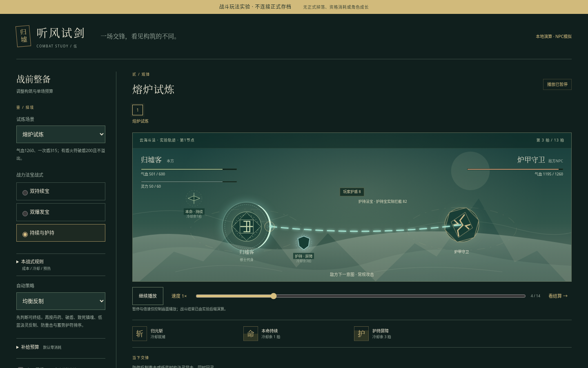
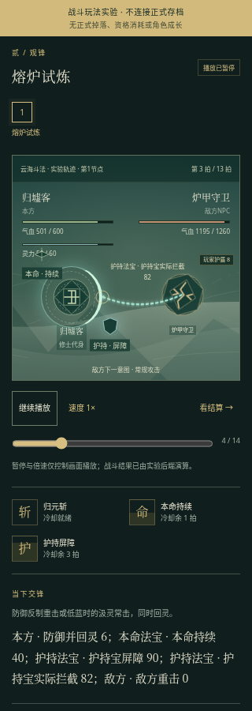
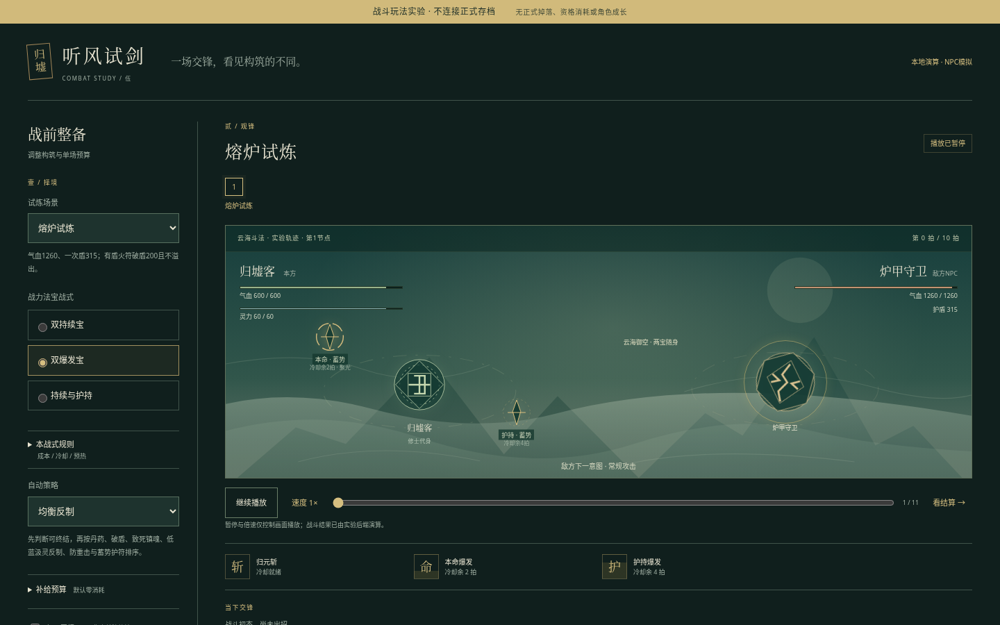
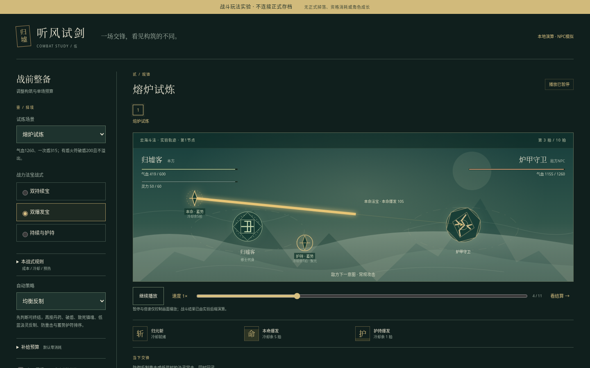

# R5 图形与自动战斗设计提案 / 独立实验规则 v1

**状态：本轮先交流评估并实证候选，不把实验冒充正式版。** PM已同意独立可运行原型`prototypes/r5-combat/`验证下列固定参数；本文不修改正式配表、存档、修为、装备或掉落。正式v1.2/R4仍保持当前已验收规则。实验有胜败/评分，但无正式奖励/排行/资格/资产写入。实验结果与多岗位交叉评审后，才能冻结正式R5实施与迁移。

## 1. 主动设计判断：把决策前移，不把手动按钮换成定时连点
用户想要的是角色和NPC自己出招、内置技能CD，配装有回报、战斗看得懂、副本推进看得见。推荐循环为**看敌机制→战前配装/同行/策略/耗材授权→自动战斗演出→原因复盘→补给或换构筑再战**。战斗中不要求点普攻、技能或法宝；不靠用户抢动画窗口反制。失败后保留合理调整空间，而不是自动必胜或只堆战力数字。

保持单机规则NPC，不能伪装真人；完整修仙原系统仍有去处：四艺提供实际丹符和装备、社交解同行、宗门/家族/阵法提供既有准备成长、洞府/地图/秘境/经济继续材料循环。月余曲线v2的540×系数、45基础日、总增速≤15%与8h恢复资格不受实验影响。修炼宝是未来速率收益，战力宝是战斗能力，不能自动兼得。

推荐先有可玩的2D舞台（角色/NPC/敌人位置、实际动作和伤害反馈），不追求重型3D。图形是权威事件的可视化，不是画面先打死再追补服务器奖励。默认约1秒/拍方便读图，界面须叫“拍”，不是谎称真实秒CD；1x/2x/暂停/跳过仅回放，结果/耗材/CD/评分一致。

## 2. 已裁决的独立实验输入与固定场景
用户输入只允许`scenario/build/strategy/pill_budget/fire_budget/guard_budget/soul_budget/npc`。不提供A/HP/MP/时间/伤害自由编辑框；QA可在引擎内部fixture测0MP/低HP，HTTP不能传fixture。所有试验都从固定玩家A100、HP600/600、MP60/60开始；无暴击/命中随机，便于比较。实验build名称不改正式物品UID/品质/原攻击或气血被动。

| 场景ID | 固定敌人 | 验证目的 |
| --- | --- | --- |
| den | HP1260、常99、重165、蚀毒12 | 自动防重击/授权清毒；稳健与抢伤取舍 |
| forge | HP1260、常99、重165、一次盾315 | 物理溢出/火符专盾、爆发启动与破盾时机 |
| tower | HP1260、常99、重165、常击抽MP6 | CD/MP双约束、自动回灵与合法降级 |
| boss | HP10^12不要求击杀、常66/重110、12玩家机会 | 玩家个人总伤/生存窗口，参考R990、评分cap1980 |
| dungeon | 三域连战：毒巢接近战420/30/50；熔炉接近战630/45/75/盾157；沉星终战1260/99/165/抽蓝6 | 3节点真实推进及资源续航；HP/MP/CD/总预算连续 |

每敌本地意图是常击→蓄势（0攻击）→重击循环，换节点本地意图重开0；玩家全局t连续。`dungeon`是独立“三域连战续航试验”，不是把正式妖巢改成跨三洲地图；无战间自动静养/补满，故与正式v1.2战间可免费静养的难度不同，结果不得直接当正式三战平衡结论。先用两弱接近战+强末战，避免3个1260硬拼导致所有构筑只缺血；一次承诺只完成这三战，不自动循环新副本。

另可用**内部短战fixture**（例如无机制HP220、常30/重50）比较1—3拍早收尾，以及den/forge/tower高压长战、Boss固定12拍，不能只拿12拍总DPS等值证明各有价值。fixture不开放给玩家改数；短战结论要看实际击杀时点，不能仅看出手数。PM复核公开连战/高压已有实质取舍，故不为增加短敌scenario阻塞首批交付；受控短战只能作为额外辅助证据。

## 3. 技能/三构筑：等预算、错峰、真实取舍
每拍只有一个主行动（技/普/防/丹符之一）；法宝和同行是独立通道，不额外增加Boss玩家机会。

- 归元斩：200伤，耗18MP，CD3，初始ready0；成功使用t则ready=t+3。
- 普攻：100伤并回MP2（不超过60）。缺MP、技能未就绪时总有合法普攻，不422热循环。
- 防御：回MP6，当前敌物理伤减半向下取整；属于真实防御，可免新毒/常击抽蓝，不能清旧毒。
- 消耗品占主行动；自动并不表示技能额外无成本齐发。

| build | 主宝 | 副宝 | 同为12拍的理论宝伤与取舍 |
| --- | --- | --- | --- |
| sustain 持续 | 40伤/CD2，初始0 | 40伤/CD2，初始1 | 0/2/4/6/8/10与1/3/5/7/9/11，各6发，共480；早期有伤、补刀平滑，单次爆点小 |
| burst 蓄势 | 120伤/CD6，初始2 | 120伤/CD6，初始4 | 2/8与4/10各2发，共480；前两拍无宝伤、长CD空窗，分段高伤窗口；不是T0双爆永远更优 |
| guard 护持 | 同持续主宝，共240理论伤 | 屏障90/CD4，初始0但只在重击将至或HP≤40%触发，持2敌机会 | 少一整条攻击通道换生存；最大90=15%HP，不叠加，触发补到90而不是加90 |

“480等值”仅指活满12拍且每次有存活目标/实际触发的理论宝伤，**不是实际Boss一定等分**。过量、护盾、提前败退、冷却跨节点、目标已死不触发都会改变结果。持续应在短目标/残局及时补刀有价值；爆发在有准备的长战/破盾后大伤包有价值；护持在高压续航活得更久，付出评分/清怪速度。若实跑发现某一类没有任何优势或全局支配，必须据数据修启动/CD/场景，而非靠文案宣称平衡。

CD完整轴：技能若按时使用则t=0/3/6/9；持续主0/2/4/6/8/10、副1/3/5/7/9/11；蓄势主2/8、副4/10；护持首次可能t2，下一次最早t6，若没有威胁则继续保持ready等待，不自动消耗。实现回放frame/event.tick以1起算展示机会编号，等于内部t+1；例如显示第1/4/7/10拍用主技，对应内部t0/3/6/9，不是CD偏移。防/丹/魂/控制跳敌不冻结t，也不让CD额外少走一拍。一次run换敌不重置玩家CD/启动；新试验才重新初值。

## 4. 自动策略与授权：致命收尾优先，保命不等于无脑嗑丹
先按同一真实时序预测本拍**合法主行动+已ready攻击宝**经过实际护盾后能否击杀；普攻可收尾优先普攻，其次合法技能可收尾优先技能，置于防御/补给之前。不能拿NPC伤害/未来尚未ready爆发假装当前可击杀；不预算内强行开技能。该规则直接吸取R4实跑“可强攻先杀却机械防御，反复嗑丹败退”的教训。

`balanced`之后依序选择第一项合法行动：
1. 有丹预算、丹ready，且HP≤40%/有旧毒/（敌蓄势且MP<18），服丹；只有实际可恢复或需清毒才使用，不空耗满状态。
2. 护盾≥100、有火符预算且ready，用火符省MP破盾。
3. 敌重击且预测即使防御也会死，有镇魂预算且ready，镇魂。
4. 沉星常击且MP<18，有镇魂预算且ready，镇魂；否则进入防御规则。
5. 敌重击防御（含妖巢防新毒）；沉星常击MP<18也防御保蓝。
6. 敌蓄势、HP≤2×敌重击、无已生效护身且有授权ready护身符，则护身，准备下一次重击。
7. 归元斩ready且MP≥18则释放，否则普攻回MP2。

`aggressive`：同样致命收尾优先；之后HP≤25%且丹授权/ready才服丹，再优先技能，否则普攻。不会自动防御或乱用三符；UI应明示其反制与生存代价，符授权不等于策略一定花完。

**PM最终预算**：pill0..3、fire/guard/soul各0..2，npc bool；全部默认0/false。丹与三符各自CD3，使用t后t+3再可用；即使有余额也不能下一拍连吃同类丹。预算按整个run共享，不因换敌、暂停、回放或切节点重置；不允许场内追加预算掩盖失败。实验是虚拟授权次数，不扣正式库存；未来正式接入还须受实际库存/保留数/演武虚拟背包规则共同约束。

- 丹：HP+80、MP+20至上限，先清旧毒并当前拍免新毒。
- 火符：有炉盾时对盾200，无溢出本体；无盾150伤。按**主行动发生时**的盾判断，不倒算后续宝先破盾。
- 护身：当前和下一敌机会物理伤再乘75%，向下取整，不等于防御，不能免毒/抽蓝。
- 镇魂：跳过本次敌行动，新毒/抽蓝不发生；旧毒仍按该机会结末发作。

## 5. 同拍时序、归属与终态（实验唯一版本）
`t=0..11`的Boss每拍最多一个玩家主行动。一般战斗同样从t0起，最多120拍整个run，无限防御/低伤不会无限跑。

1. 拍开始：展示本敌本地意图；所有ready_at≤t能力可用，读取旧毒数/状态。选择合法主行动；若服丹先清毒并设本拍免毒。
2. 结算主行动/主技：扣资源、设置对应ready_at；先盾后本体，按规则恢复MP/防御/符状态。
3. 敌仍活着才结算主宝，再副宝；每件独立检查ready/触发、写自身ready_at。护持宝按当前威胁触发屏障，伤害宝先盾后HP。某一段击杀立即胜利，不再补发未触发宝/NPC或敌/毒。
4. 敌仍活着才结算同行；可选npc=true仅实验10伤支援，初始ready2/CD3，即t2/5/8/11。先盾后本体，但**同行伤不计Boss个人分**。首批不伪装多人阵容。
5. 敌仍活着才敌行动。实际物理伤先防御半伤、再护身75%取整，最后屏障吸收；屏障最大90，至多2敌机会，过期清余量，不能越界叠到180。
6. 旧毒若存在且未丹清、玩家仍存活，先跳固定12伤并减1；毒绕过物理减伤/屏障，镇魂仍有该次旧毒。若本拍是实际未防/未魂/未丹免疫重击且仍存活，再刷新新毒2；首挂不当拍跳，旧毒1遇重击先跳旧伤、再剩2。
7. 沉星实际常击未防/未魂才抽min(6,当前MP)，不足归0不扣额外血/不拒绝整个行动。护身/屏障吸伤不免抽蓝。
8. 状态剩余敌机会收尾，t+1。敌击/毒使玩家死，终止并记录败退；敌先死已在前序结束，不出现死后反击。

Boss不靠击杀HP结束。t11玩家主行动、已实际触发的宝/NPC、敌/旧毒按上述完整结算后封窗；玩家自己法宝实际HP伤计个人分，盾伤/过量/未发生追击不计，同行始终独立列出。若第12拍敌/毒后玩家倒下，本拍已经造成的个人伤仍保留，不能抹掉；若更早败退立即停，不补到12拍。t12不再触发任何额外宝/NPC/DoT刷分。显示本次个人伤、同行伤、有效机会数、cap1980及是否提前终止；实验不发正式F(best)资产。

普通敌120拍仍未胜则`stalled`安全终止，既非胜利也不是假造HP0；报告剩余HP、技能/MP状态与停止原因，可换构筑新试验。败退/结算/节点选择都会明确停下，绝不自动再开下一run或无限刷普通物资。演出暂停仅暂停已发生事件显示，不承诺把真实已结算伤害撤销。

## 6. 图形舞台与副本推进的首批可审查结果
原型首批做单屏战前配置→2D自动舞台→结算/复盘，可运行本地独立实验，不接正式玩家档。舞台至少有玩家/敌/可选NPC明确位置、HP/MP/护盾条、主技/两法宝CD与下一敌意图；触发时角色移动/法宝闪击/盾破/中毒都对应具体事件。不能只有大段日志自滚就叫图形战斗，也不必为基本表现引入重型资源和远程费用。

三节点图由真实node状态驱动locked/active/cleared/failed；到哪场、剩余资源/总预算可见，点击未解节点不能跳怪获奖。展示“本次三域连战，不是正式游戏地图”，避免误称已经重做全部副本。未来正式版再把原三战小怪/末战、三洲/秘境/精英和世界Boss入口统一可视化；分支路线只有实际不同风险/奖励/返回状态时才画分叉，首批不画不可交互的假分支。

事件最小例（示意，实际字段由开发/架构对齐）：
```
{seq:19,tick:2,node:1,source:"player",type:"defend",mp_delta:6,reason:"妖巢重击，避免新毒"}
{seq:20,tick:2,node:1,source:"main_treasure",type:"attack",hp_damage:120,ready_at:8,reason:"蓄势法宝启动完成"}
{seq:21,tick:2,node:1,source:"enemy",type:"heavy",raw:165,after_defend:82,shield_absorbed:0,hp_damage:82}
{seq:22,tick:2,node:1,source:"rule",type:"poison_prevented",reason:"真实防御，未挂新毒"}
```
完整回放必须能还原HP/MP/屏障/毒/CD/预算，不能只给总伤与胜利布尔。末页用3条因果复盘：“爆发t2启动之前连续宝已补伤”“MP不足主技降级普攻”“重击防御避免两次毒伤”，给真实可调整项而非失败后只提示氪金/战力不足。

## 7. 正式版后续方向与明确取舍（当前未实装）
- 技能构筑：利用原归元/焚炎/镇岳三门已学功法，战前选一主技/策略，CD、MP与持续灼伤/守势分别有用途；首批实验只归元斩，不先塞三套未经验证的技能。被动/灵根/体质/阵法既有成长保留，不重复叠一套免费倍数。
- 法宝：保留原两槽及cultivation/combat方向、品质/UID/已付提质资产。战力战式候选持续/蓄势/护持场外选择、场内锁定；修炼宝不偷偷自动攻击，也不突破15%。实验固定伤包只是同预算对照，不代表正式旧法宝立刻无偿加这份伤害。
- 阵容：首步仍主角+1规则NPC同行，不膨胀四人养成；后续将已结交同伴分工为10伤/CD3、治疗20HP/CD4或回灵6/CD4择一，数值仅候选，需同预算比较；不把实验npc bool说成已实现治疗/回灵AI。世界Boss不能把同行输出算玩家冲榜。
- 自动反制：敌意图和预设条件可读，聪明默认与强攻预设共存；高难可通过换装备/单场丹符预算/同行/策略补救，仍失败可回低难、免费采药静养。不能让战斗中换装追溯CD/离线修为。
- 自动覆盖：正式新体验应覆盖原序章与所有world battle kind（野外/劫影/秘境/副本/精英/NPC竞技/跨域/世界Boss），不能只一个演武屏自动而主线仍必点普攻。旧free兼容/进行中手战保存要另定适配；保留现有battle_id/已用Boss机会/毒盾与预约，不能清空回血重置。可给旧战斗一键委托旧策略完成，下一场切新规则，而非强迫继续手点。
- “manual证明”应以后续正式规则明确区分：真正自动逐拍实战仍是新模式实战，不是扫荡回放；R4原s6文案和资格迁移必须同步，不能借实验悄改旧manual_clears。原快捷结算仍只给有真实胜利证明的同章同难，不另给预算。

## 8. 多岗位交叉与首批验收
架构已建议确定性有界仿真/权威游标，前端只演出；开发要求CD/宝先后与归属明确；视觉要求暂停含义、首日与图节点可读；QA提出0MP/旧毒/世界Boss第12拍/耗材授权/旧档反例，已纳入本候选。原型首批必须拿出可运行页面、独立数值报告和三类场景结果，不能只文档通过。

验收至少：①重复同输入得到同结果事件；②1x/2x/跳过/暂停后恢复只改播放、无数值差；③CD明确t0用→t3再用，持续0/1错峰与爆发2/4启动逐事件可核；④0MP合法普攻、不422或无限循环；⑤三机制正反例、毒旧跳后刷新、火符无溢出、护身/宝盾不能冒充防毒；⑥所有预算0不耗材，预算3/2/2/2整个run共享、CD3、不跨节点重置；⑦Boss末拍与NPC归属独立复算；⑧短战/长战/高压/连战有真实取舍，若任一构筑统治或全部卡死则记录失败调整，不提前宣称平衡；⑨图形舞台/节点/失败补救真实页面可读、键盘/窄屏/减少动画模式可用；⑩任何原型失败不污染正式档，不声称当前v1.2已具有正式自动战斗。


## 9. 策划独立实跑矩阵：现候选已有真实取舍
只读调用当前独立lab engine，5公开场景×3构筑×2策略×2预算=60格；预算0为全部0，预算2为丹/火/护身/镇魂**各2份**（不是总共2份），全部NPC关闭。`artifacts/r5-design/matrix-initial.json`保存输入/完整逐拍事件，CSV可对照；引擎SHA256 `f2b745b1d320bdca4e69796470ae7fcc36096e72f904c0be15f2aaeef20d9904`。这是纯独立实验引擎仿真证据，未冒称HTTP/真实浏览器/正式玩家档已验收；QA和PM另做独立复核，PM公开spotcheck与此矩阵一致。

| 公开实验 / 同预算条件 | 持续 | 蓄势 | 护持 | 结论 |
| --- | --- | --- | --- | --- |
| 毒巢、强攻、0预算 | 7拍胜/HP48 | 7拍败，敌余20HP | 8拍胜/HP117 | 持续补伤跨过击杀断点；爆发未等来下一轮即死，不能只看纸面DPS |
| 熔炉、均衡、0预算 | 10拍败 | 10拍败 | 13拍胜/HP130 | 厚盾+高压下护持有唯一无耗材通关价值，代价是更慢 |
| 沉星、强攻、0预算 | 7拍胜/HP72 | 7拍败，敌余20HP | 8拍胜/HP153 | 蓝被抽后持续的小伤仍及时，启动长爆发有空窗风险 |
| 三域连战、均衡、0预算 | 17拍败 | 18拍胜/HP32 | 22拍胜/HP155 | 爆发跨节点相位与主技对齐成功；护持容错血量高但多4拍 |
| Boss12拍、均衡、0预算 | 1680个人伤/HP116 | 1680个人伤/HP116 | 1440个人伤/HP296 | 同分是这一场的结果，护持实得多180HP、少240分，非全场景同质 |
| Boss12拍、强攻、0预算 | 第12拍败退，2080原伤/封顶1980 | 同左 | 活满12拍、1840分/HP76 | 可选以败退换满分，或降低分数保生存；不抹除第12拍已发生个人伤 |

**为什么蓄势在连战反而胜、不是暗加倍率：** 同一模型里持续在回放第8拍击杀熔炉，下一拍进入沉星时主技还差1拍且MP20，先普攻后被抽到16，下一拍仍不能放主技。蓄势第9拍才用主行动收掉熔炉残血，因此已ready主宝没再空放、继续保持ready；第10拍进沉星时主技已ready且MP22，主技200+主宝120首拍打320，下拍副宝120+普攻100再打220。连续CD并未重置，但清上一敌的时机改变下场技能/宝相位，保留技能窗让它18拍清尾而持续17拍败。逐帧证据可直接核，不靠新增隐藏破绽倍率。

**授权增加的反效果必须公开：** 连战均衡爆发预算2变22拍胜/HP3（用丹2/火1/护2/魂1），0预算则18拍胜/HP32；护持预算2变26拍胜/HP101，0预算22拍/HP155。物品占主行动、改变节点相位，当前局部阈值策略不保证授权后一定更强/更省。Boss均衡授权丹1也会少一个普攻、从1680降1580却HP116→196。实验UI不能写“开启药符必胜”或默认授权稀有物；复盘应显示用了什么、换掉哪一拍输出。后续正式智能策略可评估更长前瞻/可选只清毒不补血授权，但本轮不凭空加系数掩盖，不需为让所有构筑一样强而改怪。

策划评审结论：**首批三构筑都有至少一个公开优势场景和明确代价，保留现候选进入图形/协议/边界验收；不是已经全局平衡。** 还未证明真实长期配装、所有敌kind、旧档或实际玩家可理解程度，正式接入前仍须重新校准技能/MP/旧宝被动和月余经济边界。当前不修改正式应用/配表，也不要求仅为纸面好看添加新机制。

## 10. 正式副本自动推进的产品评估（仅建议，未增实验功能）
**赞成战前一次授权“自动推进本次副本”。** 已知三战没有分支时，每场后强迫点一个没有选择的“继续”不提供策略，只增加机械确认；把决策保留在战前准备/真实分支/失败复盘更合适。授权范围只能是当前run的最多三战，界面明确剩余节点和整场耗材预算；终场胜利或败退即停，不能自动开启下一正式run、消耗下一份恢复信用或无限刷练习。

默认战间免费整备沿v1.2的可静养规则，公开显示HP/MP恢复，不偷吃丹符、不多扣资格；更适合后期轻负担清日常。提供“战间停留”选择，想查看掉落/调整下一战准备的玩家可停；真正秘境路径/奇遇利益分支仍须玩家选择，不由自动策略代选。暂停演出不是这个战间停留，两者文案/状态要分开。

趣味取舍在于：省掉无意义继续键，仍保留“是否冒险/换装/准备稀缺道具”的真实选择；代价是默认免费满状态整备弱化三战连续资源压力，因此不把实验无营地的护持生存优势/跨节点CD对齐直接照搬成正式平衡结论。**当前实验三节点仍无整备、HP/MP/CD连续，是压力测试，不改它来迎合正式承诺。** 正式营地是否恢复技能CD、蓄势是否仍保启动2/4拍，以及可否换装，应在下一轮正式规则明确后重做构筑矩阵；若营地重置CD，就不能再用本实验连战爆发18拍优势宣称正式也成立。营地动作对原世界tick/NPC经济的计数亦应固定，不随1x/2x播放变动。

正式自动推进必须显示授权边界、可见失败原因与安全停止，策略/库存不足有合法降级；不会承诺所有构筑自动包过最高难。这里仅补产品判断，不扩当前独立实验或改正式存档/代码。

## 11. 第二轮视觉/玩法讨论：空中斗法与抽象修士代身

用户进一步明确修仙者应在空中斗法，人物模型可用其他载体替代，并提出参考《了不起的修仙模拟器》的法宝表现语言。本轮据此推荐：**空域里的修士灵印核心、独立御行的法宝、可读的攻防往返**。取其“法宝在角色之外真实活动、蓄势与回收有节奏、空间留白能看清攻防”的体验原则，不是放一把遮住场景的巨剑或用全屏白闪代替命中。当前独立lab改视觉代身即可，前轮60格数值、CD与机制结论不变，不接正式档。

### 11.1 三种代身的取舍与推荐
| 载体 | 代入感 | 角色/法宝识别 | 制作与扩展成本 | 本轮建议用途 |
| --- | --- | --- | --- | --- |
| 本命剑影 | 御剑修仙联想最快，剑锋方向清楚 | 容易把“我是谁”与“我的攻击法宝”混为一把剑；副宝也飞剑时更难区分 | 低；轮廓/拖尾容易，派别差异要额外补 | 用作归元技能瞬态技剑、本命宝实体；不作主角常驻身体 |
| 神识灵印 | 比完整人物抽象，但姓名/宗门印记可持续建立“这是我”的身份 | 稳定核心与外绕法宝分层，攻击来源最好读；须避免像飞船发射器 | 低至中；两层篆印/灵光与少量动作即可，有颜色/形状差异空间 | **推荐修士抽象代身**，玩家/NPC保持同类但明确名牌与阵营 |
| 门派法相 | 派别与修为感强，巨大轮廓有威压 | 大剪影容易遮敌意图/法宝和数值；常驻大像会压低小宝存在感 | 高；各派/敌种需独立轮廓与动作，窄屏缩放困难 | 作为已有精英/Boss的远景轮廓或短暂重击显形；不先做人形常驻模型 |

这里的“神识灵印”是**抽象视觉代身**，不把世界观改成主角已经舍弃肉身/全员神识离体。玩家核心使用稳定两层篆印、内核与短流苏状灵气尾迹，姓名“归墟客”始终可见，说明处标“修士代身”。核心不变成一把武器、不自行喷射长剑；出招时是在身侧凝出技剑或驱动独立法宝。敌方按身份画毒瞳印、铜炉阵核、星纹核等，仍用实际敌名；门派法相不是新加一套后台召唤技能。

与视觉交叉讨论结论：视觉接受灵印核心，同时指出“像飞船/法宝本体”的风险，故固定核心身份层、法宝独立轨道与标签；策划接受并补充副槽可攻击，标签应区分“护持槽·蓄势/屏障”，不能只写护持便让人误以为一定防御。飞剑只在对应技能/宝事件出现，不让核心与武器共用同一轮廓。

### 11.2 天空空间：先让人看懂谁打谁，再谈立体感
- 无地面人形、脚底站台或落地阴影；背景为低对比云层/悬浮碎片、缓慢层次漂移，形成飞空感。云层不能与毒/屏障同亮度抢信息。
- 主角/敌人沿同一主轴置于约画宽24%/76%，核心占据稳定区域；名牌/HP/MP不随环绕旋转。同行小灵印在我方侧后、明确“NPC同行”，不和主角同尺度。窄屏仍左右对峙，压缩背景/轨道而不缩成难读微图。
- 距离由两核间留白、投射方向与攻防往返体现。**不加可操纵飞行、上下高度优势、射程、走位碰撞或闪避判定**；空域位置只是当前对峙空间示意，不能画一个玩家以为能点击移动的地面格子/摇杆。背景远近不改变伤害。
- 我方出手大体左→右，敌招右→左；宝回收方向与攻击相反且无第二次伤害。颜色配阵营，轮廓配来源，不仅靠红/绿；源点应能回溯到修士/本命宝/副宝/NPC，避免一个中央爆点吞掉来源。
- 保留空域中心给轨迹和命中，不在核心周围堆所有说明。常驻信息优先级：双方HP/MP→下一敌意图→三能力CD→毒/护盾→本拍来源分解；完整长日志收起但可查。

### 11.3 技能、法宝与护罩的动作语法
所有视觉由实际事件/真实remaining驱动。静止环绕可平滑插值，但不能用CSS播放秒数生成CD、扣盾或预判伤害。

| 来源 | 待机/预告 | 出手→命中→回收 | 需要强调的信息 |
| --- | --- | --- | --- |
| 修士主技归元斩 | 核心短暂收束，身侧出现一次性技剑；MP/CD独立显示 | 技剑短直冲→单次斩痕→轮廓消散，核心身份不离位 | 技能名、实际MP−18、CD3；未ready/缺蓝时展示“普攻回灵”，不是无反馈等待 |
| 持续宝 | 小实体沿近外轨低幅绕行；两拍CD以两段轻标表示 | 短细弧掠出→小而清楚的命中→原轨回收；每次实际触发只一击 | 高频节律和补刀来源；回程没有再判一次伤害、没有全屏闪 |
| 蓄势宝 | 更外轨暂时减速/收束；真实余2/1拍显示分段积聚，初启与释放后长CD分别标注 | 短聚焦→更粗但局部的剑束/印击→明显单次命中→余辉回轨 | 前期没有伤害是启动代价，哪一拍将出手可预知；不T0双宝一起亮满 |
| 护持屏障宝 | 副宝位于近核防守弧；ready但无威胁可保持等待，不假放 | 实际shield事件才展开环罩→承伤按absorbed产生裂纹/淡化→耗尽或到期收回 | 90屏障与HP条分开、剩余机会可读；未承伤不自己裂、不能把毒也画成被罩挡住 |
| NPC同行 | 小核心与独立标识，光效比玩家低一档 | 从自己的位置释放短支援轨迹→实际命中→回位 | 来源是NPC；Boss本次同行伤与个人分分别显示，不混成“我打了这些” |

护身符的25%减伤用贴核薄纹/符纸标记，护持宝90点吸收用外层完整屏障条，避免两个都叫“盾”而看不出剩余。炉盾在敌核外侧，是一次独立外壳；火符打出“破盾−200 / 本体0”的真实分解，物理溢出则分盾与本体两行。旧毒固定扣HP时保留仍有量的屏障，绿色毒标与“毒伤绕盾”回执解释，不能让玩家误以为漏判。

### 11.4 同拍多来源如何聚焦：具体分镜
首轮可用“敌将重击、玩家均衡防御、持续主宝刚就绪、副宝护持触发”的真实事件来展示。当前lab只有两个法宝槽，三类是不同构筑的视觉语法，不意味着同时出现持续/爆发/护持三个法宝；爆发构筑对应两件蓄势宝，没有第三面免费宝盾。每段主轨迹上限约250ms；只高亮当前来源，其他对象降低亮度而不消失。实际没有发生的段直接跳过，不为凑演出凭空补一次齐射。

1. **拍前预告**：敌核心上方保留“重击165”；CD图标显示主宝已ready、副宝ready，玩家策略行说明“均衡：防重击避新毒”。预告从上一已结算状态就可见，不只闪100ms逼反应。
2. **主行动（约100ms）**：我方核心收束成守势，MP+6小字归到MP条；不同时画一个普攻剑影，避免防御也像打了一刀。
3. **主宝（约180ms）**：当前护持构筑的持续主宝离开自己的轨道，以细弧击敌再回收；切换蓄势构筑时对应段才替换为局部粗束，不能在护持构筑凭空加一个爆发技能。HP/盾按实际事件改变，中心仅显示本段伤；镜头只做轻聚焦，不遮住敌意图。
4. **副宝（约100ms）**：若实际触发护持，近核屏障展开并标90；若副宝是攻击式，则按其真实事件发第二条不同起点轨迹。没有事件就不画。
5. **同行（若有，约100ms）**：小轨迹从NPC核发出，来源标签不抢玩家主光效；敌此时已死就完全取消。
6. **敌招（约220ms）**：反向重击轨迹撞向我方，按“防后伤→符减伤→屏障吸收→HP伤”表现，不能先扣满HP再补回来。画面角落留下实际减免分解。
7. **状态收尾（约80ms）**：旧毒若发生则独立短绿脉冲扣HP，新毒被防则仅显示“防御避毒”；宝/符/CD更新到当前权威剩余，不自己因回收完毕再加一拍CD。

默认1x一拍约1秒，仅为演出预算；少事件可保留阅读停顿，多事件缩短轨迹并按序排，不改变已结算逻辑时长。2x压短、减少动画模式改静态方向线和状态高亮；跳过直接落到真实结算。命中不需要持续白闪/大幅抖屏，强招的冲击来自蓄势对比、方向、局部形变与明确HP变化；静音也必须看懂。

### 11.5 冷却期间为什么仍有事可看、可想
CD不是“什么都不干的6秒”：主角仍普攻回灵/防御回灵、敌意图继续变化，持续宝间歇补伤，蓄势宝显示下次窗口，护持宝等待真正威胁。前两次爆发尚未启动时，持续流先补血线；保护流可活到下一次主技。把这些节律和MP消耗显示清楚，比加无后台走位更能形成新鲜的空中斗法。

本轮已实测的可解释差别可直接作为三条实验推荐/复盘：
- 毒巢强攻持续第7拍胜、蓄势第7拍败剩20HP：连续的小命中跨过收尾断点；蓄势下一次主宝在第9拍，没能活到窗口。
- 三域连战蓄势18拍胜、持续17拍败：不是爆发面板凭空更高，而是上敌收尾时未使用的就绪宝和主技在下一敌对齐；回放可跳到节点转换处查看。
- 熔炉均衡护持13拍胜、双攻10拍败：少输出一条宝换来两机会吸收，画面应让人看见实际挡下什么，而不是只把血条变厚。

复盘最终只先给“为什么赢/输、哪项决定可改、代价是什么”三条。例如“先期两拍蓄势未出手”“MP被常击抽走，主技降级”“授权护符占用了一次输出拍”；具体事件和全日志可展开。不能把护持写成永远最优、爆发写成一定满分，也不保证加丹符总会改善——前轮预算2连战变慢/低血的反例保留。

### 11.6 本轮实际落地边界
本次lab视觉改为空中抽象代身、无地面人形；三构筑数值、战斗场景、总预算、帧/CD时序不因美术变动。独立三节点仍是无营地压力测试，不暗改成正式免费整备；正式版“本run自动推进+可选战间停留/真分支停”仍是下一阶段方向。验收要看真实画面：谁是修士、哪件宝出手、哪条轨迹命中、何时ready、盾/毒为何改HP、败因是什么；不以加了云层和一把大剑就宣布空中斗法体验完成。

## 12. PM统一裁决交叉审查（等待空中实图复核）
已只读核对`R5_DECISIONS.md`：其60格矩阵引用与本提案§9原件一致，包含补给增加可能降低表现的反例；没有把灵印说成角色失去肉身、没有高度/走位新规则，也没有把两个宝画成三条免费攻击通道。持续离轨往返、爆发真实CD预热、护持仅实际吸收反馈，设计上能区分三类身份与代价。正式自动推进/营地/CD连续仍列未实装门槛，不能借实验代替正式验证。

已联系视觉获取本轮实际air截图，优先复核桌面同拍来源、320px身份/CD、爆发预热与护持实际吸收。当前尚未看到本轮air图，不能据设计说明宣称画面通过。阻断项为：修士核与宝无法区分、残留地面人形/脚台、无实际吸收却画拦截、CD假计时、同拍特效盖住身份/血蓝/冷却、窄屏关键信息被遮。静态截图只证明所捕获状态，不单独证明动画先后、CD真实或减少动画交互已通过；动态部分须结合新截图/实际浏览器与事件证据。

### 12.1 本轮空中WIP实图初评与最终门槛
已实际查看视觉本轮`air-01-guard-absorb-desktop`、`air-02-guard-mobile`、`air-03-burst-charge-desktop`三图：无地面人形/脚台，修士灵印与两器物已有独立身份，盾余8/实际吸82及爆发初始2/4拍可读。但它们仍是**WIP截图，不是最终动作通过**。320图轨道边小标签过小、与身份区域挤压，只靠文字很难辨来源；下方CD文字可补充但不替代现场可读性。

PM进一步明确两项交付门槛，策划接受：①同形法宝替身必须真实离轨出击→命中→返回槽位，护持器物真实回护，不能稳定悬停物只发射射线就叫御宝；②敌毒核应是机制纹而不是笑脸，避免修仙空域变成卡通飞船对射。视觉须修320标签字号/位置，不盖角色身份和血蓝。最终复核将查本轮新air图及动态分段/实际浏览器说明；WIP单帧不能证明轨迹往返、CD时序或清理旧特效，当前不提前宣布最终视觉通过。

## 13. 最终air图产品复核（本轮实图，限定证据范围）
已使用截图审查方法逐张打开视觉本轮`air-final-*`四图，不把WIP或旧地面图冒充最终图。**静态产品结论：本次未见需阻断交付的身份/场景/数值可读性问题，B方向成立。** 飞行往返的完整动态不是单帧能证明，须和视觉实际浏览器测量及QA结果共同看，不能称策划独立测了完整动画。

1. **桌面护持实际吸收：状态良好。** 灵印身份核、命/护独立器物、玩家盾余8和“实际拦截82”可同时读取，敌炉核为机制几何纹而非人形站台；没有凭空第三个常驻宝。护持与攻击来源已有区分。



2. **320px护持：关键重叠已修，仍有小字风险。** 槽位缩成清晰短名并加底衬，完整CD移至下方，主角姓名/修士代身、血蓝与护持标签不再挤成一处；下方三个能力格可读。9px轨道短标签对低视力仍偏小，建议未来优先提高字号/可放大展示，但不再是WIP那种互相遮住身份的阻断。未据截图宣称符合完整无障碍标准。



3. **桌面蓄势初始：状态良好。** 两独立宝轮廓与初始CD2/4可分，预热有明确启动差异；角色核稳定不与剑形器物混为一体。截图只能证明该预热状态，不单独证明按拍变化全过程。



4. **桌面蓄势释放：方向与来源可读。** 目标处出现与本命宝同形飞行替身，局部粗束和实际105本体伤对应，原器物有锚点/标签；比固定器物只射线的WIP更符合御宝方向。视觉报告同形体实际x628→1109目标→460原槽、动态原槽降亮22%，并专测末拍player事件82→main事件83未被自动stop清掉；这是视觉浏览器实测来源，不冒称是策划测量。



本轮四图都为熔炉试炼，不能仅据它们宣称毒巢/沉星/所有NPC图形已逐一查看；毒纹去笑脸、汲灵/残毒、暂停/换节点/末拍清理、减少动画与键盘体验仍看视觉/QA对应实际证据。当前舞台无地面人形/脚台，也未用高度或射程假玩法来补画面。数值仍引用原60格，不因美术改写其持续/蓄势/护持取舍；PM统一裁决没有误述矩阵或飞行设定。此为独立实验室产品复核，不是正式v1.2自动战斗/旧档迁移通过。
