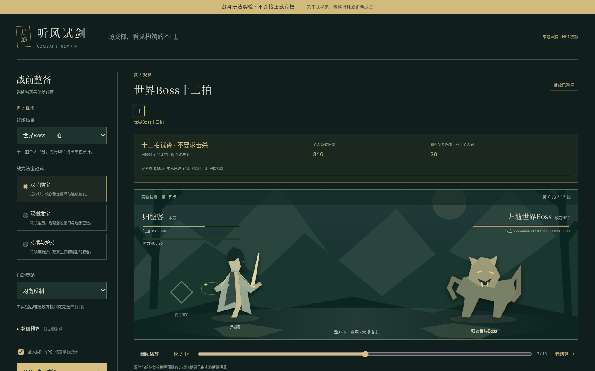
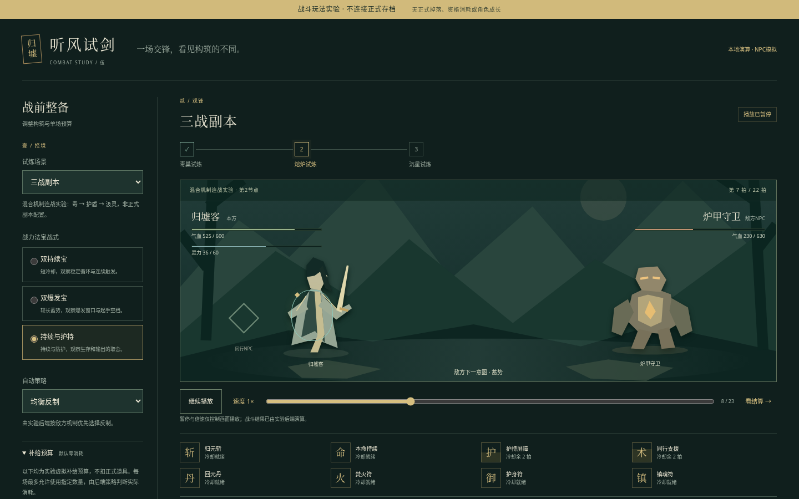
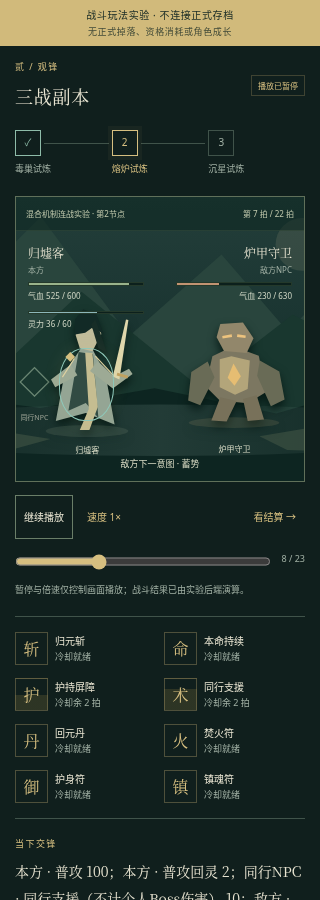
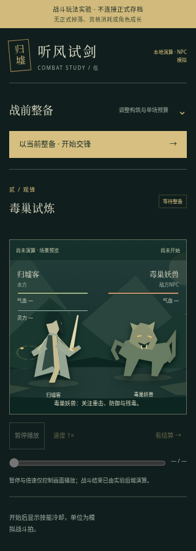
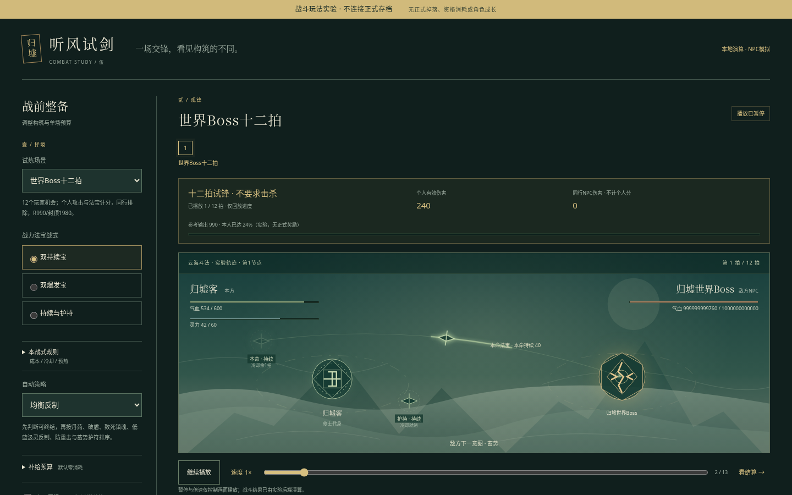
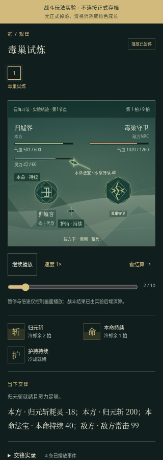

# R5 图形场景与自动交锋：视觉交互提案

状态：正式游戏R5方案仍待冻结；PM追加授权的独立实验室前端已实现并冻结，QA最终验收中。未修改正式static或玩家数据，不宣称正式游戏已接入自动战斗。已读AGENTS、README、工作室入口/任务/决策、视觉岗位、R4_UI、R4_API与当前static。本文继承单机NPC、11页、真实服务端行动与事务权益；当前R4发布验收不等于本方案通过。

## 1. 推荐方向与边界

保留“深墨青修行手札”，把正在发生的交锋和正在经过的地点变成有站位、方向、时序的画面。背景为低对比山影/石台/符纹，本方在左、敌方在右，技能轨迹穿过中线，路径节点连接实际行进顺序。战报仍可读，但不再承担全部空间与过程表达。

推荐首轮为**单战自动演算＋可控观战播放＋副本逐节点推进**：战前选功法/配装/策略，开始后无需逐次点攻击；自动结束一场后停在明确结果和下一节点入口，不默认把整个副本、奖励领取或下一份资格连点到底。实际自动化粒度、回合制/CD计量单位由策划冻结。场景负责呈现权威过程，前端不自行攻击、判胜、扣蓝或生成掉落。

优先复用SVG/CSS，不引入Canvas引擎、外部图片站、字体CDN、账号、音频自动播放或付费资源。首轮不做可走动地图、碰撞、摄像机、骨骼动画或实时多人。NPC演武/三域赛在场景与结果页均明确“NPC模拟”。

## 2. 现有缺口与信息位置

当前`world.battle`只有敌名/气血/意图/机制状态，交锋动作置顶；没有本方/同行站位、技能时间顺序、命中对象和完整胜负归因。副本筹备能选章难、看收益/机制/扫荡，进行中三战与秘境多节点仍主要靠文本和actions。不能仅给现有卡片添剑图标就称场景已完成。

入战时在当前exploration/arena工作台顶端呈现“交锋舞台”，替换大段通用页头及重复资源摘要的视觉主位；全局仍保留简短返战场提示。已有growth面板应在交锋视图折成单行入口，非战斗页恢复正常，不让900px首屏先滚过一整屏状态。离开战场仍可访问其他只读信息；自动战斗是否能继续由权威状态决定，导航本身不生成战斗行动。

普通探索页上半部：选择副本/章节/难度＋紧凑资格→实际路线图→选中节点说明/入场按钮；扫荡并排保留独立“已手战证明、消耗1份、同表结算”入口。地图不替代奖励预览、难度门槛和pending权益。

## 3. 交锋舞台与站位

桌面主舞台建议宽容器自适应、高约300–340px，上沿放地点/第几节点/模式，场内为左右两块独立地面与远山中线：

| 空间 | 图形与信息 | 交互 |
| --- | --- | --- |
| 左上 | 本方姓名、境界，气血/灵力实数与双色细条 | 可展开当前属性与来源，不遮挡战斗 |
| 左侧前景 | 自制修士剪影：衣袍、剑/法印、脚下阵纹；姓名作真实可读文字 | 持续伤害/护盾等状态贴近本体，非单靠颜色 |
| 左后侧 | 有同行时单个较小NPC剪影及“同行NPC”字样 | 无同行则不凭空放队友；Boss个人伤害不混入NPC |
| 右侧前景 | 妖兽/石傀/修士三类可辨剪影，体型/兵器变化；名字由后端提供 | 当前受击对象亮描边；攻击意图在其近旁 |
| 两方之间 | 一条有起终点的短剑光/符弧/灵气轨迹，命中时小范围闪光 | 只播放新事件，不重复请求结果或重领收益 |
| 下沿 | 技能/法宝顺序栏、当前进程、播放控件 | 技能格有名称与数字CD，可点开说明；不是可误点的手动施法按钮 |

图形是角色的示意表现，不暗示可拖动站位或自由选目标。若后端只有单敌，首轮只画一个敌人，不虚构三排阵型。每种剪影需有明确类目映射或后端`appearance`枚举；未知类型使用通用修士/灵影且名称保持准确。首轮允许8–12个本地SVG基本形状组合，质量靠统一轮廓、层次和留白，不靠巨量素材。

## 4. 自动技能、CD与法宝

战前工作台显示“当前功法/自动规则/已装备法宝/补给政策”及真实可编辑入口。用户说的持续短CD、爆发长CD是待评估构筑思路，不直接覆盖现有本命/护持两槽和修炼/战力取舍；同一法宝有何自动效果、修炼向是否参战、触发是否耗蓝/耗材均须策划明确。

技能格以横向顺序而非大卡片排列：图形符印＋名称＋“就绪 / 余2回合 / 灵力不足 / 被封印”；冷却覆盖为扇形或底边进度，同时保留文字。单位优先回合/行动；若采用秒必须给服务端战斗逻辑时间，不能把真实墙钟套到回合制。法宝持续效果在本体周围淡环，实际触发时亮一次；爆发法宝为一次短印章/剑影，不持续闪烁。悬停、焦点和点击都能读到来源、触发规则、当前CD及不能触发原因。

多技能同时触发时，视觉按服务端事件顺序排队；最多一个主轨迹与一个状态反馈并行，避免十个数字堆在头顶。不能把持续被动每帧当一次伤害，也不能在CD结束时前端自动发额外攻击请求。所有耗材策略必须战前明确；默认不静默无限吃丹/耗尽稀有符箓。

## 5. 命中反馈、暂停、速度与断线

- 普攻：起点剑光→目标短描边→气血条变化；伤害数字只停留约600–900ms，永久记录进入战报。
- 护盾：先盾纹闪亮、盾值变化，再显示穿透气血；毒显示“毒2→1”等独立次数；汲灵以蓝色流失轨迹及数值说明。免疫/未命中/无法施放必须有文字，不只无动画。
- CD与资源变化只重放后端事件数据；跳过动画也能立即看到相同终态。伤害/恢复动画不对权威数值做反复插值写入。
- 控件建议“暂停播放 / 继续播放”“1× / 2×”“看结算”。**暂停播放仅停本地演出，不声称停服务端战斗或冻结权益**。若策划选择真暂停，则另需明确动作、保存/刷新/多标签/离线规则，不能借同一个按钮含混两种语义。
- 速度只影响事件回放间隔，不改变CD、伤害、Boss回合数、世界tick或奖励。避免默认4×把所有反制与伤害原因一闪而过；减弱动态效果模式可直接逐条显示关键事件。
- 结果未知时保留最后确认画面并显示“结算待确认，重试原操作”，不自行播放胜利。409显示重读入口，不重发新战斗；刷新后定位权威战斗/结果，不从第一击重复发起。
- 切后台不依赖setInterval按秒推进权益。恢复前台先读服务端，若已经结束提示“已恢复至确认结果”，不强迫补播全部旧动画。切页/暂停不重置CD或副本资格预约。

每次演出只消费稳定event_id/seq的新事件；同request_id重复响应不再弹二次掉落，不播放两次终结技。连贯动画属于表现可丢帧，最终结果必须可恢复。

## 6. 胜负解释与战报

战斗结束保留舞台最终姿态并出现紧凑结算层，不能全屏闪白遮住原因。主信息为胜/负/撤退/回合到限、个人输出和耗时/逻辑回合、实际消耗、奖励来源与入包/待领。世界Boss专门显示个人有效伤害、同行排除、最佳是否提升、下档差值、已得/本次补差，不能用普通“胜利击杀”误导评分战。

“为何如此”至少列3种权威事实：主要伤害来源、机制影响（例如护盾吸收多少/毒触发几次/灵力不足跳过几次）、结局触发（敌方归零/本方归零/12回合评分结束）。无法从事件获得的因果不编造“装备不足”，可说明实际记录而不是保证升级一定胜。推荐下一步只链接真实配装、补给、降难或继续节点动作。

战报默认折叠普通攻击，保留机制/技能/法宝与结束事件的摘要；“全部记录”可展开按序列表，记录带出手者、目标、数字与来源。重播仅回放，不重复结算。对真实自动策略是否合理的评价要用可追溯事件，不能动画看着赢却文本判输。

## 7. 副本节点图与探索推进

副本三战采用横向连接的3个可识别节点：入口巡卫→深入伏敌→终场Boss，节点上显示完成勾/当前位置光圈/锁闭符/失败标记。锁定不只灰色，显示“先完成第1战”；击败节点后路线实线延伸到下一节点。章节/难度在图上方固定，不能选完难二图示却执行难一。

秘境沿用真实节点和奇遇分支：连接线与节点由后端定义；已访问、当前、可选、未开放状态区分；战斗/采集/奇遇/出口用不同图形并带文字。只有存在真实分支时才画分叉，不用假的地图面积显得内容丰富。点击已过节点只查看历史，点击可选节点显示代价/风险/真实行动入口；不以点击地图自动穿越数节点。探索退出与已预约权益处理明确，危险操作遵循后端confirm。

桌面路线图高约100–150px，连接线SVG为装饰，节点使用HTML button保持焦点/label；当前节点详情紧邻图，不再新叠十张卡片。自动战后“继续深入”与“退出整备”在同一处，带当前气血/灵力和剩余节点。是否允许节点间补给、是否选择后连战由策划决定。手战证明与快捷结算是独立完成方式；扫荡展示“快捷结算本章难度”与真实回执，不播放伪手战三场，不点亮从未打过的新章节点。

## 8. 320px、无障碍与性能

320px保留左右对峙的小舞台（约230px高），角色精简为剪影，姓名/HP/MP在各自上方分两行。战斗模式临时收起冗长全局摘要，保留返回导航、战名与阶段；舞台→当前事件→可换行技能格→44px播放控件→结算/下一节点。技能超过4格折为两行，不强迫水平寻找关键控件。NPC同行标记简化但仍存在。

副本3节点可放一行；更长秘境改竖向连线，当前节点优先呈现，历史可折叠。SVG保持viewBox缩放，文字不用嵌进缩小图片，中文标签不截成无法辨认的两个字。顶部固定区域不覆盖焦点或独占手机半屏。

所有关键信息有DOM文字。气血/灵力/CD meter的aria值钳制合法区间；真实数值保留可读文字。装饰SVG aria-hidden；地图节点button以“第2节点，当前，可继续”描述状态，图旁有同源的有序路线列表供辅助技术。不会把鼠标悬停作为唯一说明。

默认动画300–900ms，无频闪、无强屏震；prefers-reduced-motion去除位移/闪光/数字飘动，仍保留同样事件。战斗live region只播重要机制/结局，普通伤害不逐帧朗读；结果到达不抢走正在看的战报焦点。所有控件键盘可达，暂停按钮的pressed状态和含义明确。

使用一个可更新场景DOM、复用SVG定义，事件队列有上限/历史分页。首轮不要求WebGL、粒子系统或每击创建永久节点；动画仅transform/opacity，隐藏tab不做绘制。帧率下降只缩短演出，不改变服务端过程。

## 9. 需冻结的接口（候选，不是现行协议）

现有`world.battle`只读摘要不足完整场景。建议最小增加以下同源权威投影，字段名称由架构裁决；标准pages actions仍是唯一写入口，UI不拼造攻击请求。

| 投影能力 | 所需字段与语义 |
| --- | --- |
| 战斗身份 | battle_id、kind、page、status、mode(auto/legacy)、逻辑单位/当前步、NPC模拟标记、地点主题 |
| 站位 | actors稳定id、side、role(player/companion/enemy)、name、appearance枚举、hp/max_hp/mp/max_mp、statuses；无需前端读raw state猜属性 |
| 技能与法宝 | stable id、name、source/equipped_slot、trigger/description、cooldown_total/remaining/unit、state/reason；显示持续/爆发须有权威分类 |
| 事件 | 稳定seq/event_id、type、source_id/target_id、ability_id、气血/灵力/盾等前后值或明确delta、机制/反制文本；截断时有首尾序号与补读边界 |
| 结果 | result_id、outcome、结束原因、关键统计/消耗、reward receipt/source/pending、真实后续action引用；个人Boss评分与NPC伤害分开 |
| 路线 | run_id、chapter/difficulty、nodes[{id,label,kind,state,connections,summary,action?}]、current_node、已预约/练习说明与退出action |
| 播放/恢复 | 快照代表起态/终态须明确；事件能否一次返回、分页或补读、刷新后是否提供最近结果；真暂停若存在必须与回放暂停分开 |

优先一次事务算出确定过程并返回有界事件，客户端按事件播映；若采用分段自动推进，需架构定义每次批步action的步数/进度幂等、并发冲突、后台/离线与中断恢复。不得为“自动”让GET写入或前端每200ms发一个新request_id无上限地模拟战斗。

## 10. 交叉质疑与建议裁决

1. **全自动与现有机制冲突。** 当前护盾/毒/汲灵靠出手选择反制；若仍要求及时点火符/丹药，就不是真全自动。建议战前策略有可理解的规则与耗材上限，战内仅观战；若要保留手动接管，必须作为明确可选模式而非隐藏必需操作。策划需证明不同构筑/策略有可观察差异，不能只把八个按钮换成一个播放按钮。
2. **持续短CD/爆发长CD不等于有深度。** 都按CD自动放且无资源/时机取舍时只是两个频率。建议优先形成明确用途（稳定伤害/破盾窗口/保护/灵力压力），先保证2–3种可辨玩法，避免同时新增十几个法宝效果和复杂优先级编辑器。具体效果与数值归策划。
3. **真暂停/倍速复杂度高。** 把模拟秒、真实UTC增长、Boss周期混用，会发生离线跳过机制或多标签套利。推荐先采用确定性逻辑步＋纯表现暂停/倍速；暂停文案明确“仅演出”，不声称可挽回已结算失败。
4. **所有信息同时动会淹没战斗。** CD扇形、毒圈、护盾、伤害、NPC触发不能全高亮。每步一个主事件，其余汇成状态，战报保留细节；先用三个实体与六个左右技能格验证320px，再决定加量。
5. **不新增巨型首页。** 既有总览目标按钮在1440×900接近底部；交锋用独立工作台焦点视图并折短非战斗摘要，场景与地图不常驻堆在所有页顶。普通总览仍按真实近期目标优先，不为了展示新图挤走操作。
6. **路线图不能伪造探索。** 当前副本真实结构就是三战，首轮画真实三节点足够；只画确认存在的分支。节点历史与手战/扫荡证明分离，不能动画刷过就授予手战证明。
7. **旧存档/旧模式不是透明兼容。** 旧进行中手动战斗如何恢复、原丹符/法宝收益如何映射、Boss12回合如何保留必须策划/架构明确；本方案不授权清档或默默改旧装备效果。可以保留legacy展示直到一场旧战结束，再用新模型开启下一战。

已向策划发出暂停/倍速、法宝现有槽位与自动耗材策略的冻结需求；向架构发出稳定事件序号/actor/路线/result及恢复语义需求。等待PM统一裁决，再由前端实施，不先猜API。

## 11. 分批交付与验收门槛

A：冻结自动化粒度、策略、CD单位/法宝映射/旧战兼容，选1普通敌、1盾精英、世界Boss一条完整权威事件样例；评审桌面/320线框的主位与噪声。

B：本地SVG舞台＋事件播放器＋完整文字回退＋胜负解释，真实后端从开始到结果；验证暂停/倍速/减弱动态效果不改变同场胜负与权益。

C：真实三节点副本/秘境路线、当前节点与继续/退出/扫荡区分；保留资格预约、pending、request幂等和原11页。

D：QA独立验证真实不同构筑/CD/法宝触发、盾毒汲灵反馈、Boss个人评分、未确认响应/409/刷新后台多标签、旧战恢复；1440×900主场景/主要操作首屏可发现，320无溢出且键盘/读屏路线可操作。截图需实际过程，设计图不冒充运行证据。

初始方案阶段未实施正式代码；后续PM追加独立实验授权，范围与实际检查见第13–14节，正式游戏仍待上述A冻结再接入。

## 12. 当轮现有界面截图审查（隔离实例）
按product-design:audit的截图先行方式，使用隔离ClockHTTP真实生产Handler/Store，合法完成53步序章入世；不读取或创建主data角色。以下为本轮新截图，已逐张打开检查：

1. **副本筹备，规则清楚但空间感弱。** `artifacts/r5-lab/ui/01-current-preparation.png`：章难/资格/保底与扫荡分开可辨，主要区域仍是纵向文字行，暂无当前副本节点路线。保留这些真实条件，把三战位置与推进关系图形化；这张是滚动到筹备后的视口，不冒充首页首屏。
2. **桌面交锋，执行入口完整但画面缺失。** `02-current-battle-desktop.png`：普攻/强攻/防御与禁用原因清楚，约一屏仍只是多个操作行，无法直观看到敌我站位或技能先后。自动战斗实验以舞台＋状态/CD替代逐次点按钮，仍保留文字记录。
3. **320px交锋，单列可读但过程被长列表占据。** `03-current-battle-mobile.png`：触达按钮和换行存在，短视口只能容纳少数动作；应默认聚焦场景与播放，战前复杂配置折叠，而不是把同一长列表缩成小字。

截图可见禁用原因/焦点边框和文字反馈，不能据此宣称读屏、色彩对比或全部键盘流程合规。审查未执行完整副本/胜负归因，属于实际现有界面定向审查，不以帮助文档或旧截图替代。

## 13. 独立可运行实验室（PM新增授权）
实现位置为`prototypes/r5-combat/static/{index.html,styles.css,app.js}`，实验后端由开发负责；正式`static/`与存档完全不变。固定实验banner、所有补给标明虚拟预算；无正式资格、成长、掉落或排行榜。实验接口GET `/api/config`与POST `/api/simulate`，只播放后端生成frames；frame.node为1基，nodes.status=complete显示已通过。

场景为本地SVG组合：修士衣袍/剑/法宝环、妖兽与石甲守卫、同行NPC标记、层叠山影与石台、护盾圈。CD格为只读信息；暂停/1×2×/重播/滑动时间轴/节点回看/看结算均不发送POST。新模拟AbortController与generation隔离旧请求/动画，隐藏tab暂停播放。敌方气血归零淡化形象并明确节点结束，不再显示下一攻击意图。

实验三节点明确为“混合机制连战实验”（毒→护盾→汲灵），不是正式某个副本配置；正式方案仍只图示真实巡卫/伏敌/终场节点。Boss独立突出十二拍窗口、不要求击杀、按已播放权威damage事件累计的个人输出（player/main/secondary）与NPC单列、参考输出进度，不用近乎不动的巨大气血条冒充击杀进展。

移动默认收起整备并提供“以当前整备开始”按钮；提交后保持场景焦点，避免先滚完整配置。技能CD单位“拍”，零CD写“冷却就绪”，不保证灵力/条件已齐；已播放战报解释实际策略选择和不足，未自行猜解锁。修炼向法宝/正式既有15%上限没有在此实验中改写。

首轮实际Chromium联调已验证真实三战23帧（含初态）、仅重新演算1次POST、暂停/倍速/重播/跳尾零额外POST、帧气血对齐响应、320无横向溢出与无JS错误；QA独立评审指出complete映射后已修。最终截图与最新验收状态由下节补充，不能将实验表现当正式游戏已接入。

## 14. 实验前端冻结与交接

三份前端文件已冻结：index `095325de9fda5ce7be70cbed0c8b77794d57a7d98ae3c0c5cc0cc9b59d5e3745`，styles `2ad814b03c9e5779bfdadb5740e7cd273d5ac8ce464469dd9d66219bacd71991`，app `c45af31c0921e427e23572942861b21a23af8df7110578bba57c0a8f71ee96d0`。正式static/app仍为R4冻结SHA `d00bc80fdef318a5d43b06f9084996ea309cd92ea60a740463c3f56baee24231`。

实际定向检查：node语法通过；真实POST三战响应23帧，按帧核对HP；暂停/1×2×/重播/跳尾/滑轨仅1次原始模拟POST，后续零POST；三个complete节点均显示已通过；真实Boss帧累计个人与NPC分开且最终与metrics一致；320无横溢/无JS错误。移动默认折叠整备，初始快速开始按钮y214.30/h44，舞台y390.83/h286，均在320×900首屏内。辅助动画尊重prefers-reduced-motion；更完整键盘/错误/并发/规则验收由QA独立执行，不用本次自测代替。

当轮真实实验截图已保存在`artifacts/r5-review/ui/`：
1. Boss中途：12拍窗口/个人分/NPC单列可见；主场景与播放按钮在1440×900首屏。
2. Boss结果：结束原因及真实指标，未伪称击杀或获得正式奖励。
3. 三战中途：混合机制路线第二节点/盾敌人及CD。
4. 320观战：左右站位、路线、播放和技能格可读。
5. 320结果：个人/NPC与虚拟补给消耗。
6. 320新页入口：固定实验声明、折叠整备、快速开始和场景同屏。

截图为实验后端实际结果，非正式奖励/存档证据。SVG轮廓/背景均为本轮本地代码自制，无外部资源许可或账号依赖。未新增音频和付费调用。剩余风险是实验构筑/策略能否迁入正式平衡、现有进行中战斗升级与完整世界联动；这些不属于本lab已完成范围。

## 15. 战前规则补丁checkpoint（空中方向前历史版本）
PM必要补丁：准备区新增默认折叠“本战式规则”，选战式读取config.build_details的effect/cd/initial_delay及preparation_rules.common/consumables；含主技能18MP/CD3、持续40/CD2、爆发120/CD6/t2与t4预热、护持90/CD4和丹符占唯一主行动。全部来自实验后端metadata，不由前端写死战斗数值。单选构筑仅保留紧凑名称，完整规则在可键盘展开区，不把所有长描述平铺。
实际Chromium：3种战式各字段及共同/耗材行与真实GET配置逐字一致，选择/展开零POST，320整备与规则默认折叠且无横溢。node语法通过，截图07/08位于artifacts/r5-review/ui。该checkpoint SHA：index8a034841bd6c927522aed2d21bc6332dc269df3e0d51e6757292e878abc5c5ae；styles31cd79a833b2963d735c302285b8aa35edd14253ffebb70773c84ae0ca223f96；app9179a0a0c5565271aa2d3f2ed2a20d90edbe3faaaa03894ea19dd86a90535c7d。
用户随后要求空中斗法，故这是地面历史checkpoint，不作为最终视觉交付冻结；原地面截图保留，不覆盖冒充空中方案。

## 16. 第二轮：空中斗法与三种代身（待PM裁决）
用户明确修仙者飞天，人物难做可以其他方式代替；法宝表现参考《了不起的修仙模拟器》的抽象设计原则。此处仅借鉴“器物独立飞行、环绕蓄势、攻防路径清楚、灵气流动、爆发预兆与收束”，不复制游戏素材、造型、配色资产或UI排布；不声称已查阅/提取其美术文件。

### 16.1 三方案对比与推荐
| 方案 | 具体画法与代入 | 主要风险 | 制作/可读性 |
| --- | --- | --- | --- |
| A 御剑剑影代身 | 一枚大剑影悬空代表修士，姓名固定其下；其他器物围绕 | 主角剑与攻击法宝易混，触发时难辨是修士还是槽位效果；无剑流派不协调 | 制作较低；轮廓明确但身份区分弱 |
| B **神识灵印代身（推荐）** | 稳定双层篆印/灵光作为修士的抽象在场标记，姓名与“修士代身”说明始终可见；本命/护持为外圈独立器物 | 易像法宝或飞船，需用静稳身份核与独立轨道标签消歧 | 制作较低；主角、法宝、技能三层身份最清楚 |
| C 门派法相剪影 | 云中半透明法相/袖影悬空，法宝独立悬停 | 需要多套法相，覆盖场景/法宝轨迹；在320像模糊人物背景 | 制作较高；仙感强，首轮噪声和资产量最大 |

推荐B，A可仅作为“技能飞剑”的表现语言，C留后续正式资源方向。灵印不是新世界观设定“角色失去肉身”，只是低资源观战代身，不改变角色身份/装备类型/修炼收益。已向主策划提出身份混淆风险；策划同样推荐灵印核心＋独立飞剑载体，无高度、射程或可控飞行新机制。

### 16.2 构图与图层（不加新面板）
替换现有地面石台、树干和站立人形为云海空域：远层淡山峰低于云面，中层两条缓慢灵气云带，近层浮空阵纹。保持原舞台尺寸与左右HP/MP位置，图层不越出画框；地图节点仍在原位，属于实验进度不暗示飞行路径碰撞。

本方身份核中心在舞台约x24%/y58%，敌方在x76%/y58%，两核均悬空无落地阴影。身份核约44–56px，固定姓名对照；两宝为18–24px独立器物（印/梭/盾棱），停位在身份核的上外侧与下内侧，标“本命”“护持”。不能将身份核本身标成法宝。同行NPC为后左小型异形灵印与“同行NPC”文字，不冒充第二个人玩家。

敌方保留实际名字与type差异：毒巢以不对称毒纹核、熔炉以方棱炉印与盾环、沉星以星盘符印；Boss扩大外缘威压纹，不靠巨大血条表达评分。装饰云/灵气使用低对比细线，HUD文字区背后保持暗底。角色核稳定，法宝可缓慢环绕但不跨越姓名或触达区域；减少动态模式下全部停驻仍可识别。

### 16.3 真实事件动作分镜
| 事件/依据 | 预兆→路径→命中→收束 | 读图重点 |
| --- | --- | --- |
| 普攻（source player，decision attack） | 身份核小幅亮起→一条细白剑气直线→敌核短描边→轨迹消散 | 修士主行动，不动法宝实体 |
| 主技（source player，decision skill） | 小型剑符闪印→短金色飞剑穿过中线→短束命中→飞剑收回/消散 | 明确主技能消耗/CD仍在原HUD |
| 持续宝（source main/secondary，build sustain；或guard主宝） | 对应槽位器物亮起→细青金弧线穿梭至目标→一枚命中印→归轨 | 每次真实触发只一趟，非持续每帧虚构伤害 |
| 爆发宝（source main/secondary，build burst） | 真实remaining为2/1时对应器物周边分段聚光→触发时聚焦→较粗金束/大剑影一次冲击→余辉快速收束 | 启动预热与释放分开，未ready不假放；不同槽位轨道可辨 |
| 护持（type shield/source secondary/target player） | 护持器物向核心收拢→透明灵罩展开→承伤时一小片描边亮/裂纹→随权威盾状态退去 | 不把保护误当伤害；无事件不自扣护盾 |
| 敌方攻击 | 敌核预亮→右向左暗金/赤色线→本方短描边→消散 | 攻防方向直接可辨，不能每击都只朝右 |
| 焚火破盾/汲灵/毒 | 依据现有事件type/source/target与decision，使用短火弧/逆向蓝流/核旁毒纹 | 保留精确数字与文字，不能只换轨迹颜色 |

法宝实体始终在其槽位附近，触发时可离轨后返回；技能飞剑是临时载体而非第三个永久法宝。事件顺序按响应，不将动画当模拟时间。1×每帧约1300ms，主要动作以约120–250ms短镜头排列，整帧演出限在播放间隔内；2×缩短整套时间，无需强迫每个普通事件都重型演出。主技能/法宝/NPC/敌方同时发生时，最多一条主攻轨迹＋一处状态反馈，其他在文字记录中保留；不得把5种粒子同时盖住CD和核心。

节点跳转、滑轨回看、新模拟、暂停/结束时，清理所有临时轨迹/定时器，不让旧敌核的受击残留新节点。回看静态帧不自动补打一遍所有历史法宝。prefers-reduced-motion去除环绕/位移/闪光，只以槽位描边、图形标记和事件文字表达。

### 16.4 质疑与待裁决
- 主推荐B的核心应是**身份标记**，不能让核心与外圈宝都用相同发光圆球；建议身份用双层篆印、持续器用细梭、爆发器用锐棱、护持器用盾印，不靠颜色独自区别。
- 借鉴的是“器物在场＋真实触发可追踪”，不是堆常驻螺旋/屏震。先做三类真实source差异，再考虑环境灵气，不扩法宝数量/技能或新战斗规则。
- 在320px上，器物与身份核间距至少约12px，HUD/姓名不旋转，当前CD仍读数字；敌方机制纹不盖住血量文字。
- 整场实验仍一次真实POST生成frames；不因视觉飞行增加射程/闪避/高度、改数值或API。正式接入、旧战迁移与世界联动仍未获本实验自动授权。
- **需PM裁决**：确认B或其他代身、两宝独立轨道与上述三类分镜后才替换lab静态。当前仅方案讨论，尚未生成空中截图；地面图作为历史保留，后续新图使用air-*名称不覆盖。

## 17. 空中方案已裁决与实际落地（取代第16节待裁决状态）
PM已正式批准B并授权替换lab场景，数值/API语义不因美术变化。地面历史图片未覆盖；空中最终图片使用`air-final-*`。

实现：云海/浮空阵纹替换石台、树干和人形；稳定双层灵印为修士代身，只有两个独立槽位器物。持续梭、爆发锐棱、护持盾印按真实build选择，guard没有白得第三件爆发宝。敌核用机制裂纹/符印，不再出现面孔；同行另有NPC小印。两槽标签固定，本体出击使用同形SVG飞行替身，原槽器物降亮22%但标签不动，离轨→目标→停留→返回真实轨道；不是固定炮台只射线。轨迹端点带方向标记。

窄屏轨道旁仅9px短槽名，不再塞6px全称/CD；CD完整数字留既有下方技能格。修士姓名/“修士代身”与副槽标签分开，不重叠。舞台保持原高度，整备默认折叠与快速开战入口保留。

表现全部从真实事件消费：main/secondary damage攻击本体；shield target enemy仅破敌盾；secondary shield target player展开护持；新增真实shield_absorb以实际amount点亮迎击侧并画敌→我边缘的拦截线，绝不当副宝攻击。`decision_reason`原样显示后端实际选支原因；未从UI猜策略。毒/汲灵保留文字数值，护罩不虚构抵消旧毒。

`remaining`为2/1拍时的爆发聚光是快照状态，不用CSS秒推进CD。事件队列按后端顺序播放，每段同形飞行约本段时长82%，末段留时间回原槽，1×/2×只缩放演出。自然到末帧后等待1100ms/速度让该拍队列完整演完才停止；明确pause/skip/seek则立即取消后续演出。新模拟、seek、跨节点清理旧timer、事件属性与飞行替身；SVG原核和数值均不由动画写回。减少动态模式不创建animateMotion，仍有静态路径、槽位高亮与中文来源。

### 实际定向检查
- node语法检查通过；真实forge guard第3拍：护持展开90、实际拦截82、末态盾8，对应真实event_id，策略原因逐字对齐。
- 真实burst初态主宝2拍、副宝4拍；有真实主宝damage帧显示burst来源，未ready不凭空发招。
- 正常1×实际采样同一main飞行替身12个位置，x从628到1109（目标）再回460（原槽附近）；不是只观察装饰悬浮。原槽降亮、身份核稳定。截图本身只能证明瞬间，离轨/回收依据此DOM时序采样。
- 真实三战guard末拍22，观察到player事件82→main事件83且main flight=true；自然结束未再截断该拍后续法宝击杀。
- seek至0后无飞行g、无旧event_id；减少动态320无animateMotion且真实来源仍可读；320无横向溢出，无JS异常。暂停/倍速/回看仍不产生额外POST。
- 此为前端定向检查；QA完整实验suite、异步/键盘和最终浏览器独立结论以QA报告为准，不重新声称正式游戏自动战斗已接入。

冻结SHA256（取代第14/15节历史前端hash）：
- index.html `a3f68bdec51ca148ef56965df76c52b750846233bc77fef7b02ab1f23066cebf`
- styles.css `bda71f9f0f2fb33a581fd62f2f0a6fac921859c5d9a9545cb938e5ea344ed383`
- app.js `1e8dfbca97c6cd1b92377599c19dd92a2b8e9fb4a7f9be57e01d9228eaab5631`
正式static/app.js仍为R4 `d00bc80fdef318a5d43b06f9084996ea309cd92ea60a740463c3f56baee24231`，无修改。

最终真实截图（1440×900/320×900，均本轮实际后端响应）：

来源可观测性：`#arena`的data-simulation-id/frame-tick/event-id/event-tick/current-source/current-target/effect只描述当前权威frame内事件；`[data-actor=player|enemy|npc]`为身份，`[data-treasure=main|secondary]`为两个固定槽位，真实飞行g为`[data-flight-source][data-event-id]`。静态seek优先真实吸收、再法宝真实伤害、再其他法宝事件；逐条播放保持后端顺序。不可拿静态优先摘要顺序冒充全部事件时序。

另保存真实播放中通过现有“暂停播放”控件截获的离轨时刻，不是静态seek假造出招：`air-final-flight-desktop.png`（Boss持续宝第1拍，真实main事件3，离槽约342px）、`air-final-flight-mobile.png`（毒巢持续宝第1拍，真实main事件3，离槽约96px），采样元数据见`air-flight-capture.json`。这两图可以看见原槽暗轮廓与中线同形器物，不新增第三槽；完整返回仍以动态采样为证。

